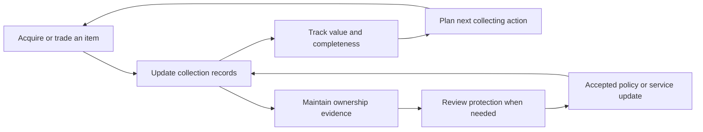

# Collectibles Markets and Retention Opportunities for Objais

**Research date: 13 October 2026 | Global scope with Brazil and Europe highlighted**

Collectibles offer a credible way to explore recurring use for Objais because owners can repeatedly catalogue acquisitions, complete sets, compare trades, monitor values and maintain records. **TCGs are the strongest first candidate for testing engagement; valuable coin collections are a useful parallel candidate for testing insurance economics.** This is a research judgement, not a validated expansion decision.

The opportunity requires more than adding asset categories to the existing estimate screen. Objais would need to provide a useful collection workflow and capture some continuing commercial value. A collector can visit every week while generating only one payable insurance lead. Increased activity alone would leave the original acquisition-cost problem unresolved.

Lead selling is the working commercial assumption; actual retention has not been established. Actual contracts, renewal rights and cohort results were not available. The company’s earlier public research remains in [Objais Company Products and How They Work](Objais Research Report.md).

The accompanying workbook contains **116 numeric records**, a **50-source register**, a **12-platform comparison**, an editable economics model, market assessments and research gaps. The CSV contains the numeric records. Every record retains its period, geography, unit, qualifier and source. Publisher and platform claims remain labelled; hypotheses and illustrative model inputs are separate from observed data.

# Conclusions supported by the research

There is evidence of considerable activity in the proposed markets. Circana reports strong growth in collectible toys, including trading cards and figures. Hasbro reports continuing Magic revenue growth into the first half of 2026. These indicators establish product demand, not retention or insurance demand. [Circana 2025](https://www.circana.com/post/global-toy-industry-rebounds-in-2025-as-sales-rise-7-fueled-by-pop-culture-collectibles-and-kidu), [Hasbro H1 2026](https://newsroom.hasbro.com/node/36961)

The clearest software engagement signal comes from Collectr’s own 2025 recap: millions of users, extensive inventory records and more than a billion annual app uses. Catawiki reports that returning buyers account for most sales across its special-object marketplace. These show that collecting can support repeat activity, while leaving Objais’s ability to acquire and retain those users unproven. [Collectr recap](https://www.linkedin.com/posts/collectr-inc_2025-was-a-year-were-still-processing-at-activity-7413235631927001088-Joi6), [Catawiki FY24](https://www.catawiki.com/en/press/1860-catawiki-crosses-100m-revenue-mark)

The main competitive finding is equally significant: scanning, portfolio tracking, price histories, trade comparison and social sharing already exist. A promising position for Objais would connect collector records to appropriate protection, insurer-accepted documentation and updates as collections change. Its ability to deliver that position must be established with users and underwriting partners.

# How to interpret market size

## Different quantities describe different opportunities

| Measure | What it measures | What it cannot establish |
| --- | --- | --- |
| Manufacturer revenue | Revenue booked by a producer or brand | Total retail sales, resale volume or collectible holdings |
| Retail sales | Purchases through tracked consumer channels | All private trading, collection values or insurer revenue |
| Marketplace GMV | Value transacted through a platform | Platform revenue, profit or unique physical assets |
| Auction sales | Prices realised through auction activity | All dealer and private transactions or typical collection size |
| Grading volume | Items added to grading population reports | Unique collectors, unique physical cards or sales value |
| Registered users | Accounts or company-defined users | Monthly active users or retained cohorts |
| Collection inventory value | Estimated value of objects held | Cash available, sale proceeds or contractual insured value |

These figures should not be added together. A card can be sold by a manufacturer, resold on a marketplace, graded and auctioned, appearing in several datasets. Existing collection value is a stock; annual sales are a flow. Neither is automatically Objais’s revenue opportunity.

## Quantitative overview

| Indicator | Latest relevant observation | Scope and interpretation |
| --- | --- | --- |
| Global toy sales | USD 123bn in 2025; +8% | Circana whole-industry estimate, broader than collectibles |
| Collectible toy growth | +32% in 2025; almost 19% of toy sales value | Circana tracked G12 scope; includes cards and figures |
| Tracked toy sales | +14% in H1 2026 | Circana G14; different coverage from G12 |
| US action figures and accessories | +10% in H1 2026 | Category sales growth, not all collectible figure resale |
| Magic brand revenue | USD 1.7201bn in 2025; USD 1.0149bn in H1 2026 | Manufacturer revenue includes tabletop and digital |
| Pop Mart figure toys | RMB 12.0226bn in 2025; +73.3% | One producer’s figure category, not global figure TAM |
| Funko net sales | USD 908.2m in 2025; USD 207.719m in Q2 2026 | Multi-brand issuer; Q2 sales +7.4% |
| Brazilian toy retail | BRL 10.39bn in 2025; +1.86% | ABRIN statement citing Abrinq; all toys |
| Heritage numismatic auctions | Above USD 470m in 2025 | One auction house’s coins and currency |
| Stack’s Bowers auctions | Above USD 325m and 134,000 lots in 2025 | Numismatic auction channel proxy |
| Global art and antiques report scope | Estimated USD 59.6bn in 2025; +4% | Arts Economics; broader than an antiques-only segment |
| EU art market report scope | Estimated USD 8.4bn in 2025; +3% | EU subset of the global estimate |

Sources: [Circana global estimate](https://www.circana.com/post/global-toy-market-hits-123b-as-play-expands-across-ages-and-markets), [G12](https://www.circana.com/post/global-toy-industry-rebounds-in-2025-as-sales-rise-7-fueled-by-pop-culture-collectibles-and-kidu), [G14](https://www.circana.com/post/circana-reveals-regional-toy-market-dynamics-across-europe-the-americas-and-asia-pacific), [US H1](https://www.circana.com/post/us-toy-industry-posts-strongest-first-half-in-six-years-circana-reports), [Hasbro FY25](https://corp.hasbro.com/news-releases/news-release-details/hasbro-reports-fourth-quarter-and-full-year-2025-financial), [Hasbro H1](https://newsroom.hasbro.com/node/36961), [Pop Mart FY25](https://www1.hkexnews.hk/listedco/listconews/sehk/2026/0325/2026032500285.pdf), [Funko FY25](https://investor.funko.com/news-and-events/press-releases/Press-Releases/2026/Funko-Reports-2025-Fourth-Quarter-Full-Year-Financial-Results-Provides-Full-Year-Outlook-for-2026/default.aspx), [Funko Q2](https://investor.funko.com/news-and-events/press-releases/Press-Releases/2026/Funko-Reports-Strong-Second-Quarter-2026-Financial-Results-Reiterates-Full-Year-Net-Sales-Outlook-and-Raises-Adjusted-EBITDA-Guidance/default.aspx), [ABRIN](https://abrin.com.br/industria-de-brinquedos-supera-10-bilhoes/), [Heritage](https://www.ha.com/heritage-auctions-press-releases-and-news/heritage-auctions-closes-2025-above-2.15-billion-for-its-fifth-consecutive-annual-sales-record.s?releaseId=5383), [Stack’s Bowers](https://stacksbowers.com/sbpressreleases/stacks-bowers-galleries-announces-record-shattering-325-million-year-of-auctions-in-2025/), [Art Basel](https://www.artbasel.com/stories/the-art-basel-and-ubs-global-art-market-report-2026).

The public evidence does not establish comparable global totals for physical TCG resale, action figure resale, numismatics and antiques. It also does not establish a defensible national collectible-specific TAM for Brazil. Applying collectible shares from international toy tracking to Brazil’s total toy retail would introduce an unsupported assumption.

# Trading card games and sports cards

## Demand and activity

TCGs combine gameplay, collecting, fandom and trading. Different buyers pursue different outcomes: playable decks, favourite characters, complete sets, graded rarities or sealed products. Sports cards are an adjacent category with different licensing and player-performance influences; they should not be treated as interchangeable with TCGs.

The Pokémon Company’s March 2026 figures report more than 85bn cards produced across its history, 16 languages and sales in more than 90 countries and regions. Those figures describe production and reach, not annual monetary sales. Its business page reports roughly 1,800 card gyms and 300,000 annual events in Japan as of May 2026, illustrating organised-play infrastructure. [Corporate figures](https://corporate.pokemon.co.jp/en/aboutus/figures/), [TCG business](https://corporate.pokemon.co.jp/en/business/cardgame/)

GemRate’s September 2026 recap reports approximately 3.52m additions across tracked major graders, up 62% year on year, excluding Beckett. About 60,000 CGC AUTH additions affect the period. Its method compares population-report snapshots, which can also change through recategorisation. This is a current activity signal, not a sales census or count of distinct collectors. [September recap](https://www.gemrate.com/september-2026-recap), [Methodology](https://www.gemrate.com/faq)

## Recurring tasks and retention hypothesis

A collection can change after every purchase, pack opening, trade or sale. Set completion and trade decisions create reasons to revisit records even when the owner is not considering insurance. This is the mechanism worth testing; monthly visits should not be assumed for every collector.

Potential recurring tasks include adding cards in batches, distinguishing variants and languages, recording duplicates, maintaining want lists, comparing a proposed trade, and updating ownership after a sale. An insurance-oriented version would additionally preserve purchase evidence, grading certificates, storage records and an up-to-date collection schedule.

## The competitive standard

Collectr already advertises scanning, portfolios, trade analysis, pricing and social tools. Its current homepage claims more than 10m collectors, without an audited active-user definition. Its PRO price is USD 59.99 billed annually or USD 7.99 monthly. [Collectr product](https://www.getcollectr.com/), [PRO](https://www.getcollectr.com/pro.html)

Its year-end recap claims 6.3m users, 1.3bn app uses, over 700m inventory entries and more than USD 100m of partner GMV in 2025. These support the existence of substantial recurring activity in the category. They do not provide cohort retention, paid conversion or Collectr’s net revenue. [Collectr 2025 recap](https://www.linkedin.com/posts/collectr-inc_2025-was-a-year-were-still-processing-at-activity-7413235631927001088-Joi6)

CollX documents visual matching with user selection of variants, daily pricing and fallback estimates when recent sales are missing. It explicitly says condition is entered manually. This is a useful precedent for separating identification from grading. [CollX FAQ](https://www.collx.app/faq)

eBay has launched AI card scanning with historical pricing and population data, and expanded card authenticity and grading features. Its platform combines recognition with transaction context. Competing solely on the ability to photograph a card would therefore be difficult. [eBay FY25 product developments](https://www.ebayinc.com/stories/news/ebay-inc-reports-fourth-quarter-and-full-year-2025-results/), [Q2 2026 developments](https://www.ebayinc.com/stories/news/ebay-inc-reports-second-quarter-2026-results/)

## Insurance fit and commercial implications

The strongest prospective insurance users are adults with material collection values, useful records and an interest in protecting holdings. Casual players with low-value bulk cards may be good users of a free tracker while producing limited insurance revenue. A large audience and a valuable insurable audience must be measured separately.

A US provider explicitly markets Pokémon collection insurance, including inventory responsibilities and scheduling for individual items or sets above USD 25,000. This establishes a product precedent, not availability for Objais’s Brazilian or European customers. [CIS Pokémon offering](https://collectinsure.com/pokemon-insurance/)

**Research judgement:** begin with a narrow adult collector segment and a documentation workflow that connects to actual underwriting requirements. A generic multi-game scanner would face strong competition before establishing an economic advantage.

# Action figures designer toys and related collectibles

## Category boundaries and demand

Action figures, designer vinyl toys, statues, plush collectibles and diecast models have related collecting behaviours but different identification and condition requirements. A loose mass-market figure, a boxed limited edition and a premium statue are different valuation problems.

Pop Mart’s 2025 annual report separates figure toys from plush and other products; more than half of total revenue was plush. Its H1 2026 total revenue grew 23.8%, but overseas revenue fell approximately 11.1%, calculated from reported segment values. Europe and other regions grew only 5.9%, following much faster prior-year expansion. This illustrates why a successful global brand does not imply uniform regional momentum. [Annual results](https://www1.hkexnews.hk/listedco/listconews/sehk/2026/0325/2026032500285.pdf), [Interim results](https://www1.hkexnews.hk/listedco/listconews/sehk/2026/0820/2026082000353.pdf)

Funko reported a USD 67.4m loss in 2025 and returned to sales growth in Q2 2026, including 9% growth in its Core Collectibles category. Its quarterly profit included a tariff-related benefit. These are company-specific results that caution against treating every collectible brand as a growth story. [FY25](https://investor.funko.com/news-and-events/press-releases/Press-Releases/2026/Funko-Reports-2025-Fourth-Quarter-Full-Year-Financial-Results-Provides-Full-Year-Outlook-for-2026/default.aspx), [Q2 2026](https://investor.funko.com/news-and-events/press-releases/Press-Releases/2026/Funko-Reports-Strong-Second-Quarter-2026-Financial-Results-Reiterates-Full-Year-Net-Sales-Outlook-and-Raises-Adjusted-EBITDA-Guidance/default.aspx)

## Recurring needs and existing tools

Collection updates, release tracking, wish lists, missing variants and purchase records provide plausible repeat tasks. Box condition, completeness, accessories, edition, scale and authenticity affect what needs to be recorded. An image of the character alone may not identify the saleable configuration.

hobbyDB / Pop Price Guide already offers collection management, value tracking, exports, wish lists, image matching and trading tools. An annual plan is advertised at USD 29.99. Its pricing documentation distinguishes completed-sale evidence from references it cannot verify. [Plans](https://www.hobbydb.com/marketplaces/poppriceguide/subs/pop-price-guide-landing-page), [Price sources](https://help.hobbydb.com/support/solutions/articles/36000247575)

**Research judgement:** figures are a sensible second market if Objais can support exact product variants and document collections efficiently. The launch should focus on a catalogue-defined niche and avoid relying on the current popularity of one character or brand.

# Coins banknotes and numismatic collections

## Separate numismatics from bullion

A numismatic object’s value can depend on rarity, grade, mint, date, provenance and specialist demand. Bullion is more closely linked to metal content and spot prices. Ancient coins introduce additional provenance and trade questions. These require distinct records and underwriting discussions.

The US Mint’s FY2025 report lists USD 490.1m of numismatic revenue and 2.9m units, alongside separate bullion revenue of roughly USD 1.6bn. These are one issuer’s primary sales. The workbook marks these as official indexed report extracts because the complete PDF could not be retrieved during review. [US Mint report](https://www.usmint.gov/content/dam/usmint/reports/2025-annual-report.pdf)

Heritage and Stack’s Bowers disclose substantial numismatic auction activity, providing visible secondary-market proxies. Their totals leave dealer trading and private sales unmeasured and should not be presented as global TAM. [Heritage annual results](https://www.ha.com/heritage-auctions-press-releases-and-news/heritage-auctions-closes-2025-above-2.15-billion-for-its-fifth-consecutive-annual-sales-record.s?releaseId=5383), [Stack’s Bowers](https://stacksbowers.com/sbpressreleases/stacks-bowers-galleries-announces-record-shattering-325-million-year-of-auctions-in-2025/)

## Collection behaviour and competition

Numista offers a collaborative catalogue, collection records, pictures, personal notes, swaps and forums. At review its homepage displayed roughly 540,000 catalogue types and 1,677 swap ratings over 30 days. These are activity and taxonomy signals, not monthly active-user counts. Portuguese is among its supported site languages. [Numista](https://en.numista.com/)

Potential recurring work includes recording new acquisitions, checking missing dates or mint marks, organising swaps, attaching certificates and preparing an estate or insurance inventory. Exact grade and evidence of authenticity matter; a visual match should not be promoted as authentication.

## Insurance opportunity

Howden Portugal expressly lists coins and antiques among collections for specialist placement. That confirms local market precedent for valuable collections, while leaving acceptance criteria, prices and particular TCG products unresolved. [Howden Portugal](https://www.howdengroup.com/pt-pt/cover/fine-art-insurance)

**Research judgement:** coins are a useful parallel test because collection documentation can be important and specialist insurance already exists. Start with modern or certified coins whose identity can be recorded clearly. Keep bullion and ancient coins in separate workstreams.

# Antiques and archaeological antiquities

## Two different expansion choices

“Antiques” can refer to furniture, decorative objects, ceramics, clocks and other older possessions. “Antiquities” often refers to ancient or archaeological objects. Treating both as one automated recognition category would obscure differences in provenance, title, regulation and appraisal.

The Art Basel / UBS report estimates a large art and antiques market, but does not furnish a clean worldwide resale total for every antique or vintage object. The report’s online channel was USD 9.2bn in 2025, or 15% of sales, illustrating that substantial value continues to move through other channels. [Art Basel report summary](https://www.artbasel.com/stories/the-art-basel-and-ubs-global-art-market-report-2026)

Catawiki’s FY24 results are relevant to repeat buying across special objects: nearly half a million returning buyers accounted for 90% of sales. Its 3.5m auctioned objects span multiple categories. This prevents the inference that antique collectors necessarily buy infrequently, while not establishing an antiques-only retention rate. [Catawiki results](https://www.catawiki.com/en/press/1860-catawiki-crosses-100m-revenue-mark)

## What could support recurring use

Provenance records, receipts, expert reports, restoration history, transport, lending and inheritance documentation are plausible continuing tasks. Their timing is less uniform than set completion in cards. Collection records may be valuable even without weekly use, particularly if they reduce effort during insurance review or a claim.

Mass identification and instant pricing are harder when objects are unique, repaired or ambiguously attributed. A promising entry point would be a specialist-assisted record, with valuation confidence and evidence clearly distinguished.

## Trade and provenance constraints

EU cultural-goods import controls have applied since 28 June 2025 and impose category-specific documentation requirements. Brazil’s IPHAN administers antique and art dealer registration and restrictions on the export of specified cultural goods. These are material requirements for a service facilitating trade or documentation of older objects; they should not be generalized to every modern card or toy. [European Commission](https://trade.ec.europa.eu/access-to-markets/en/news/eu-introduces-new-import-controls-cultural-goods), [CNART](https://cnart.iphan.gov.br/cnart/), [Brazilian cultural exports](https://www.gov.br/iphan/pt-br/servicos/saida-de-bens-culturais-do-brasil)

**Research judgement:** selected decorative antiques could complement Objais’s existing art proposition. A broad archaeological-antiquities launch is a poor first retention experiment because specialist and provenance requirements dominate.

# Brazil and Europe

## Brazil

Brazil has an established toy market and TCG product infrastructure. COPAG’s historical social report documents six Pokémon expansions and 57 new products in 2023, an example of repeated local releases rather than a current market-size estimate. Brazilian card marketplaces and stores are relevant distribution prospects, but this review did not verify their GMV or user totals. [COPAG launch record](https://copag.com.br/balancosocial/pdfs/clientes-e-fornecedores-distribuindo-sorrisos.pdf)

Global and US prices cannot simply be converted to BRL and called local market value. Language, condition, supply, import costs and actual local transactions need to be considered. Store asking prices and collector-to-dealer offers also measure different points in the transaction.

A particularly important underwriting finding appears in Porto’s residential wording effective 5 December 2025. Its art extension explicitly excludes antiques, numismatics, philately and archaeological objects on **printed page 72, PDF page 73**. It also excludes unspecified objects and several forms of disappearance or fraud. This illustrates a coverage gap in one product, not a conclusion that the entire Brazilian insurance market excludes collections. [Porto policy wording](https://www.portoseguro.com.br/content/dam/documentos/condicoes_gerais/seguro_residencia/habitual/cg-resid-veraneio-premium-private-dez-25.pdf)

The first Brazilian commercial requirement is therefore explicit underwriting acceptance for the intended collectible category. A generic art or home policy label is insufficient. Obtain category, location, valuation, transit, dealer-inventory and claims-documentation terms before promising a photo-based insurance journey.

## Europe

Cardmarket’s anniversary disclosure reports more than 2m users across 30 countries, more than 600m lifetime sold articles and more than 500m active offers. These establish a substantial specialised ecosystem, without disclosing annual GMV or retention. [Cardmarket company disclosure](https://www.linkedin.com/posts/cardmarket-com_tradingcardgames-activity-7328071468594995200-smOn)

Circana reports strong adult purchasing of toys in Europe. Its regional data groups several major European markets but excludes Portugal from the tracked-country list; Portugal-specific demand should not be inferred from the aggregate. [G12 results](https://www.circana.com/post/global-toy-industry-rebounds-in-2025-as-sales-rise-7-fueled-by-pop-culture-collectibles-and-kidu), [Regional definitions](https://www.circana.com/post/circana-reveals-regional-toy-market-dynamics-across-europe-the-americas-and-asia-pacific)

Portugal offers relevant specialist insurance and numismatic infrastructure. INCM publishes recurring numismatic programmes, while Howden describes collections placement. Neither establishes a mass-market collector policy or a ready partnership for Objais. [INCM programme](https://loja.incm.pt/pages/plano-numismatico-2025), [Howden](https://www.howdengroup.com/pt-pt/cover/fine-art-insurance)

Europe also contains different jurisdictions and currencies. UK evidence should not be treated as EU product availability. For example, Hiscox’s UK page says its standalone collections product is no longer offered to new customers, despite other pages still describing collection insurance. [Hiscox current availability notice](https://www.hiscox.co.uk/existing-customers/collections-insurance)

# Competitors and distribution channels

| Platform | Relevant role | Consequence for Objais |
| --- | --- | --- |
| Collectr | Card portfolios, prices, scanning, trades and social tools | A generic collector dashboard competes with an established specialist |
| CollX and Ludex | Card identification, inventories and pricing | Identification needs a specific advantage or integration |
| PriceCharting | Cards, comics and games pricing, inventories and API | Potential reference provider; rights and limits require agreement |
| Cardmarket | European TCG marketplace | Distribution and price context, with restricted API access |
| eBay | Transactions, recognition, grading and authenticity | Strong incumbent with transaction data and existing buyers |
| Whatnot | Live commerce and collector communities | Possible distribution context; entering live commerce adds a separate business |
| hobbyDB / Pop Price Guide | Figure and toy catalogues, values and trading | A figure tracker needs reliable variants and a reason to switch |
| Numista | Numismatic catalogue, collections and swaps | A strong specialist reference and community |
| Catawiki | Curated auctions across special objects | Evidence of repeat commerce and a potential channel, not an assumed partner |
| Specialist insurance intermediaries | Collection placement and claims requirements | Possible counterparties for ongoing protection workflows |

Sources: [Collectr](https://www.getcollectr.com/), [CollX](https://www.collx.app/faq), [Ludex](https://collections.ludex.com/), [PriceCharting](https://www.pricecharting.com/pricecharting-pro), [Cardmarket](https://www.linkedin.com/posts/cardmarket-com_tradingcardgames-activity-7328071468594995200-smOn), [eBay](https://www.ebayinc.com/stories/news/ebay-inc-reports-fourth-quarter-and-full-year-2025-results/), [Whatnot](https://www.whatnot.com/seller), [hobbyDB](https://www.hobbydb.com/marketplaces/poppriceguide/subs/pop-price-guide-landing-page), [Numista](https://en.numista.com/), [Catawiki](https://www.catawiki.com/en/press/1860-catawiki-crosses-100m-revenue-mark), [Howden](https://www.howdengroup.com/pt-pt/cover/fine-art-insurance).

Whatnot reports USD 8bn of seller sales in 2025 and claims 80% of customers buy monthly. It spans many categories, and the monthly-purchase claim lacks a published cohort denominator. It is a useful signal of recurring commerce, not an insurance conversion benchmark. [Whatnot seller page](https://www.whatnot.com/seller)

**Distribution hypothesis:** specialist shops, grading submissions, auction purchases and collection-management platforms could supply users at relevant moments. Imports of existing records could reduce onboarding effort. None of these channels or integrations is secured by the public research.

# Insurance needs and product boundaries

## Why collections can create ongoing work

A collection changes when items are acquired, sold, moved, graded, restored or lent. Its documented value and insured amount can diverge. An ongoing service could help preserve records, notice a material change and prepare the information required for a review. The insurer must determine whether an endorsement or valuation is accepted.

US Collectibles Insurance Services advertises collection-level protection, inventory responsibilities, scheduling for high-value individual items and an optional 1% monthly increase in cover. That contractual option demonstrates one way to accommodate growth; it is not a forecast of appreciation and is not an Objais feature. [CIS overview](https://collectinsure.com/)

The provider’s exclusions include gradual deterioration, atmosphere-related damage, voluntary parting and mysterious disappearance. Coins involving gold or platinum have separate handling. The category pages also contain inconsistent dealer deductible descriptions, so the dataset avoids treating those amounts as settled terms. [CIS categories and exclusions](https://collectinsure.com/what-we-insure/)

## What must remain separate

| Item | Required distinction |
| --- | --- |
| Identification | A catalogue match does not prove authenticity or ownership |
| Condition | A user description or photograph is not automatically a professional grade |
| Price | Asking price, realised sale, dealer purchase offer and replacement value differ |
| Value update | Changing an app estimate does not change contractual cover |
| Protection | Purchase guarantees, shipping protection and ongoing collection insurance differ |
| Owner type | A collector’s belongings and a dealer’s commercial inventory can require different policies |

The insurance opportunity should be measured at collection level, not by multiplying the number of cards printed by a premium per card. Many inexpensive items may form a valuable aggregate collection; many printed items will never become insurable demand for Objais.

# Data requirements and feasibility

## Minimum collection records

| Category | Fields needed beyond a general photograph |
| --- | --- |
| TCGs | Game, set, number, language, variant, quantity, raw condition or grading company/grade/certificate, acquisition evidence |
| Figures | Manufacturer, franchise, edition, scale, SKU, packaging, accessories, completeness, condition and receipt |
| Coins | Issuer, denomination, date, mint mark, variety, metal, dimensions where relevant, grade, certificate and provenance |
| Antiques | Description, materials, dimensions, maker or attribution, period, provenance, restoration and expert records |

These are analytical requirements to test with specialists, not a verified specification of Objais’s current implementation.

## Available reference routes and restrictions

PriceCharting advertises a USD 49 monthly API tier. Its documentation states that the API provides current values but not historical prices or historical sales. A subscription should not be assumed to permit unrestricted commercial redistribution. [Plans](https://www.pricecharting.com/pricecharting-pro), [API documentation](https://www.pricecharting.com/api-documentation)

Cardmarket currently says it is not accepting new API applications. An expansion plan cannot assume immediate access. eBay Product Research provides a seller interface for up to three years of sales, including actual accepted prices, but that does not establish a bulk feed or reuse licence. [Cardmarket API](https://help.cardmarket.com/en/cardmarket-api), [eBay research](https://www.ebay.co.uk/sellercentre/news/2024-june/product-research?targetgroup=B2C)

Pricing quality depends on exact variant matching, condition, geography, recency, number of comparable sales and treatment of outliers. Scarce observations should produce a visibly limited estimate or specialist referral. The reference dataset must distinguish observed transactions from inferred prices.

## User records as a possible advantage

The strongest prospective advantage is a useful, portable record built over time: ownership changes, evidence, valuations and insurer decisions. This can reduce repeated work without trapping users in a proprietary format. It becomes commercially defensible only if owners value it and insurers or partners accept the resulting documentation.

# Retention and revenue model

## Three measures of continuing value

| Measure | Example of success | Failure that can look like success |
| --- | --- | --- |
| Product retention | Users return to add acquisitions or complete a collection task | Notification opens without useful action |
| Revenue retention | Renewals, paid tools or repeated paid services contribute margin | Users return but generate no additional revenue |
| Partner retention | Shops or insurers repeatedly use a useful workflow | Partners buy a few leads and stop after poor conversion |

The proposed cycle is an analytical concept, not an implemented product:

## Economic test

Contribution over a defined period should include **accepted paid leads, net subscription revenue, contractual renewal income and net referral or transaction revenue**, then subtract acquisition, data, processing, payment and service costs. Fixed development and operating costs must subsequently be covered.

An illustrative workbook cohort assumes 1,000 acquired users, 40% activation and 0.15 accepted paid leads per activated user at EUR 40 net each. That produces EUR 2,400 in lead revenue. At EUR 3 acquisition cost per user and EUR 2 variable service cost per activated user, contribution is **minus EUR 1,400** before fixed costs.

Adding a hypothetical 5% annual paid conversion at EUR 30 net and 1% net revenue on EUR 50 of annual partner GMV per activated user adds EUR 800, leaving **minus EUR 600**. Every input is illustrative, not an Objais price or industry benchmark. The example shows why increased engagement and additional features must earn more than they cost.

Renewal income is set to zero in the model because the current working assumption is a one-off lead model. If Objais secures renewal rights, they should be modelled with actual contract economics. Repeat visits or repeated quote requests should never be counted automatically as new payable leads.

## Candidate commercial models

| Model | What must be validated |
| --- | --- |
| Lead generation with collector tools | Better qualification or lower acquisition cost exceeds tool operating cost |
| Ongoing insurance distribution | Accepted servicing role, renewal remuneration, claims responsibilities and local permissions |
| Paid collection documentation | Owners pay for reliable records, exports or professional services despite free alternatives |
| Shop or dealer software | Partners pay for inventory/documentation workflows; dealer insurance remains distinct |
| Embedded partner offering | Distribution and revenue sharing work without requiring a standalone app habit |

An embedded or partner offering may be worth testing alongside a consumer app. Established collector platforms already have engagement; insurance-oriented documentation could complement them if commercial and technical access are available.

# Market comparison and priorities

The assessment is qualitative. It does not convert missing retention or acquisition data into numerical scores.

| Market | Recurring use potential | Insurance opportunity | Principal difficulty | Suggested research priority |
| --- | --- | --- | --- | --- |
| TCGs | High for active collectors | Concentrated in valuable collections | Strong incumbents and exact variant/condition data | First engagement test |
| Coins and banknotes | Moderate for active collectors | Potentially strong for valuable holdings | Authenticity, grading and bullion distinctions | Parallel insurance test |
| Figures and designer toys | Moderate to high in selected niches | Depends on aggregate collection value | Packaging, variants and fashion cycles | Second wave |
| Decorative antiques | Variable | Relevant for valuable collections | Heterogeneous objects and specialist appraisal | Selective complement to art |
| Archaeological antiquities | Unproven | Highly case-specific | Provenance, title and trade requirements | Defer broad rollout |
| Comics, vintage games and diecast | Plausible adjacency | Collection-dependent | Each needs separate data and user validation | Watch list |

The initial audience should be **adult collectors who manage their own valuable holdings**, with dealers evaluated separately. Frequent acquisition of inexpensive items and ownership of a valuable collection are different selection criteria. Wealth level alone is a poor proxy for either need.

# Proposed research and validation

## Questions for collectors

Ask users to show how they currently document purchases, identify variants, update ownership and determine values. Establish what they did in the last month rather than asking only whether they would use a future app. Include current users of Collectr, Numista and hobbyDB to understand switching costs and missing tasks.

Record collection size and value bands, recent acquisition/sale frequency, current tools, time spent, evidence retained, existing insurance and willingness to pay for a specific completed task. Segment by adult hobbyist, valuable-collection owner and commercial dealer.

## Questions for insurers and distribution partners

Confirm collectible categories, territory, collection and item limits, minimum premiums, valuation basis, acceptable proof, transit treatment, new acquisition rules, claims documents and renewal remuneration. Ask what causes a submitted request to be rejected or repriced. Get explicit answers for cards and figures rather than relying on an art policy description.

For shops and grading partners, test whether a purchase or submission can produce useful collection records and whether they benefit from the resulting service. Ask about data rights, revenue sharing and support requirements before treating the channel as cheaper acquisition.

## A bounded pilot proposal

One practical research design is two small adult cohorts, for example 30 TCG collectors and 30 coin collectors, observed for 60–90 days. These are proposed sample sizes, not a statistical power calculation. Compare a collection documentation workflow with the existing estimate-only journey, using random allocation where feasible and avoiding claims of causality from an uncontrolled small sample.

Measure meaningful-action retention at 30, 60 and 90 days, new records, record completeness, corrections, accepted insurer submissions, realised net revenue and service cost. Track free-tool users who never express an insurance need; otherwise the experiment can mistake hobby engagement for insurable demand.

Before recruitment, set decision thresholds against Objais’s baseline and budget. Continue only if users complete recurring useful tasks and the commercial path shows credible positive contribution. A pilot should also establish whether users want a separate app, an import/export service or a feature within an existing platform.

# Remaining gaps and excluded interpretations

The reviewed evidence does not establish the size of Objais’s obtainable market, its collector retention, its lead economics, or signed access to insurers and data suppliers. Exact Brazilian and Portuguese collectible-category revenue remains unresolved. Those are the next inputs needed for a bottom-up commercial estimate.

Several attractive-looking statistics should not be used as shortcuts:

- Cards printed are not cardholders or insurable collections.
- Total toys are not collectible figures alone.
- Platform sales and manufacturer revenue overlap.
- Returning buyers’ share of sales is not a cohort retention percentage.
- Monthly purchases across all secondhand goods are not TCG purchase frequency.
- A rare auction record does not describe an average item or insurance lead.
- An advertised data API does not establish commercial redistribution rights.

The dataset deliberately preserves these boundaries. It also distinguishes an older observed period from a current snapshot and records source limitations, including inaccessible full documents and animated counters that disappear from text extraction.

# Source register and deliverables

The workbook’s Sources sheet is the complete register, with 50 entries, URLs, periods, evidence basis, access dates and limitations. The principal source groups are listed below.

| Source group | Principal references |
| --- | --- |
| Toy retail and regional behaviour | [Circana global](https://www.circana.com/post/global-toy-market-hits-123b-as-play-expands-across-ages-and-markets), [G12](https://www.circana.com/post/global-toy-industry-rebounds-in-2025-as-sales-rise-7-fueled-by-pop-culture-collectibles-and-kidu), [Regional H1](https://www.circana.com/post/circana-reveals-regional-toy-market-dynamics-across-europe-the-americas-and-asia-pacific), [US H1](https://www.circana.com/post/us-toy-industry-posts-strongest-first-half-in-six-years-circana-reports), [ABRIN](https://abrin.com.br/industria-de-brinquedos-supera-10-bilhoes/) |
| Publisher and manufacturer results | [Hasbro FY25](https://corp.hasbro.com/news-releases/news-release-details/hasbro-reports-fourth-quarter-and-full-year-2025-financial), [H1 2026](https://newsroom.hasbro.com/node/36961), [Pokémon figures](https://corporate.pokemon.co.jp/en/aboutus/figures/), [Pokémon business](https://corporate.pokemon.co.jp/en/business/cardgame/), [Pop Mart FY25](https://www1.hkexnews.hk/listedco/listconews/sehk/2026/0325/2026032500285.pdf), [H1 2026](https://www1.hkexnews.hk/listedco/listconews/sehk/2026/0820/2026082000353.pdf), [Funko FY25](https://investor.funko.com/news-and-events/press-releases/Press-Releases/2026/Funko-Reports-2025-Fourth-Quarter-Full-Year-Financial-Results-Provides-Full-Year-Outlook-for-2026/default.aspx), [Funko Q2](https://investor.funko.com/news-and-events/press-releases/Press-Releases/2026/Funko-Reports-Strong-Second-Quarter-2026-Financial-Results-Reiterates-Full-Year-Net-Sales-Outlook-and-Raises-Adjusted-EBITDA-Guidance/default.aspx) |
| Activity and repeat buying | [Collectr recap](https://www.linkedin.com/posts/collectr-inc_2025-was-a-year-were-still-processing-at-activity-7413235631927001088-Joi6), [Cardmarket](https://www.linkedin.com/posts/cardmarket-com_tradingcardgames-activity-7328071468594995200-smOn), [GemRate recap](https://www.gemrate.com/september-2026-recap), [GemRate method](https://www.gemrate.com/faq), [Catawiki](https://www.catawiki.com/en/press/1860-catawiki-crosses-100m-revenue-mark), [Whatnot](https://www.whatnot.com/seller), [eBay survey](https://www.ebayinc.com/recommerce-report/) |
| Auctions and market estimates | [Heritage](https://www.ha.com/heritage-auctions-press-releases-and-news/heritage-auctions-closes-2025-above-2.15-billion-for-its-fifth-consecutive-annual-sales-record.s?releaseId=5383), [Stack’s Bowers](https://stacksbowers.com/sbpressreleases/stacks-bowers-galleries-announces-record-shattering-325-million-year-of-auctions-in-2025/), [US Mint](https://www.usmint.gov/content/dam/usmint/reports/2025-annual-report.pdf), [Art Basel](https://www.artbasel.com/stories/the-art-basel-and-ubs-global-art-market-report-2026), [UBS](https://www.ubs.com/us/en/wealth-management/who-we-serve/ultra-high-net-worth-investors/art-advisory/art-basel-art-market-report.html) |
| Collection tools and data access | [Collectr](https://www.getcollectr.com/), [CollX](https://www.collx.app/faq), [Ludex](https://collections.ludex.com/), [hobbyDB](https://www.hobbydb.com/marketplaces/poppriceguide/subs/pop-price-guide-landing-page), [Numista](https://en.numista.com/), [PriceCharting](https://www.pricecharting.com/pricecharting-pro), [API](https://www.pricecharting.com/api-documentation), [Cardmarket API](https://help.cardmarket.com/en/cardmarket-api), [eBay research](https://www.ebay.co.uk/sellercentre/news/2024-june/product-research?targetgroup=B2C) |
| Insurance and provenance | [CIS](https://collectinsure.com/), [Exclusions](https://collectinsure.com/what-we-insure/), [Pokémon cover](https://collectinsure.com/pokemon-insurance/), [Howden Portugal](https://www.howdengroup.com/pt-pt/cover/fine-art-insurance), [Porto wording](https://www.portoseguro.com.br/content/dam/documentos/condicoes_gerais/seguro_residencia/habitual/cg-resid-veraneio-premium-private-dez-25.pdf), [Hiscox availability](https://www.hiscox.co.uk/existing-customers/collections-insurance), [EU cultural imports](https://trade.ec.europa.eu/access-to-markets/en/news/eu-introduces-new-import-controls-cultural-goods), [IPHAN register](https://cnart.iphan.gov.br/cnart/), [IPHAN exports](https://www.gov.br/iphan/pt-br/servicos/saida-de-bens-culturais-do-brasil) |

The report provides interpretation and category comparison; the workbook provides the auditable numeric register and editable scenario model. None of the scenarios constitutes measured Objais performance or a completed product rollout.
