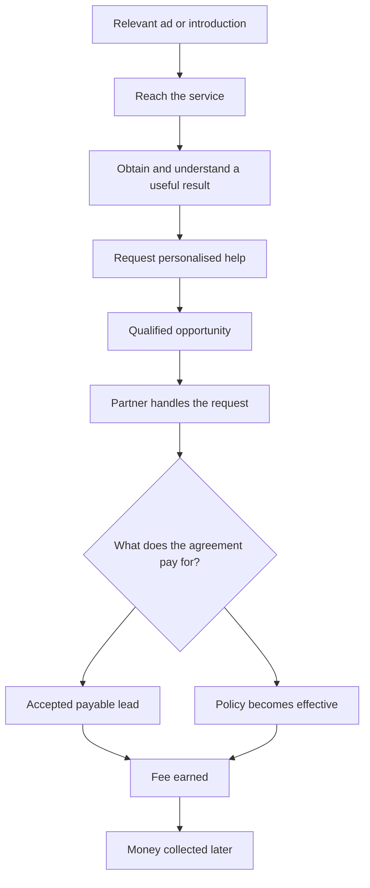
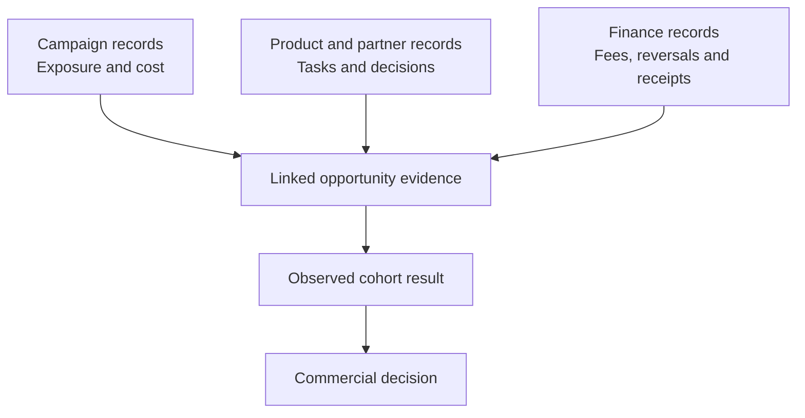

# Objais Acquisition: What Turns Attention into a Worthwhile Customer?

**Reviewed 14 October 2026. Worked examples are illustrative; dated publisher list prices are public-source observations, not Objais quotes. Portugal is the first research market, not a finding that it is the best market.**

Objais can attract someone with a simple promise: photograph an asset and get an idea of what insuring it could cost. But the business has to complete a longer chain. The person needs to reach the service, obtain a useful result, understand it, ask for help and reach the contractual payment condition that earns Objais a fee.

Advertising and the service journey need to produce useful, serviceable requests at an affordable cost. Cheap clicks may bring people who only want to try the recognition feature. A clear experience may produce more requests that a partner cannot serve. A good insurance enquiry may earn too little to cover acquisition. Each problem calls for a different change.

This guide connects the parts through one example, then changes its assumptions to show what would improve the result. It complements the [revenue model numerical summary](<Objais Revenue Model Numerical Summary.md>): that guide follows owners and payments over time; this one explains how acquisition and the first service journey produce those inputs.

Unfamiliar terms link to the [shared glossary](<Objais Glossary.md>). The examples can be followed in order without reading it first.

## Current product focus and optional future venues

The acquisition baseline is Objais's publicly described photo-based indicative premium estimates, collection management and specialist introductions for supported valuables, cars, boats and pets. This is marketed scope, not proof that every category can be fulfilled in both countries. Health/home availability is inconsistent across public pages and Business is forthcoming; exclude these from initial campaigns until confirmed. [Objais Insurance](https://objais.com/en/insurance), [Objais Select](https://objais.com/en/select), [Objais Family](https://objais.com/en/family), [Objais Business](https://objais.com/en/business)

[Trading card game (TCG)](<Objais Glossary.md#trading-card-game-tcg>) communities are an optional future way to reach owners. Card recognition, grading, transaction integrations, auction tools and locally placeable card insurance are not established current capabilities. The community material below is exploratory and does not add an active TCG pilot to the initial campaign. Start with a current, serviceable product and a matching destination.

[The venue prices and requirements research](<Objais Advertising Prices and Requirements.md>) separates ads Objais could buy from promotions reserved for auction houses. It also distinguishes public list prices from prices available only on request. The funnel below shows how to judge a purchase by the requests and fees it produces.

## The person and the records behind the funnel

The consumer examples follow people and their possessions. Three possessions do not make three [asset owners](<Objais Glossary.md#asset-owner>), and a staff member acting for someone does not automatically create another customer.

Someone might arrive through Google Search, an Instagram advertisement or a watch dealer. [Acquisition cost (CAC)](<Objais Glossary.md#acquisition-cost-cac>) per new owner needs to include all attributable spending on bringing them in, including introduction fees and onboarding work.

Before the owner is known, Objais may observe only a click, a website session or an app instance. Those are different counting units. One person can click twice, install on two devices or return later. Measurement should preserve what is known and leave uncertain identity links unresolved.

A [payable event](<Objais Glossary.md#paid-event>) earns a fee under the agreement. Each request needs its own commercial record. The revenue guide uses “paid event” for the same thing; both describe entitlement, not cash already received.

| Record | What it represents | What would cause a counting mistake |
| --- | --- | --- |
| Click or session | An observable interaction with an ad or destination | Treating every interaction as a different owner |
| Owner | A distinct person whose possessions are being considered | Counting each item or representative as another person |
| Asset | A possession or collection item | Assuming every new item earns another fee |
| Opportunity | A request or transaction being pursued | Counting retries as new enquiries |
| Payable event | A contractual condition for earning payment | Assuming any partner acceptance is payable |
| Fee and receipt | Money earned and the later money received | Counting collection as another revenue event |

Keep these records separate and link them when the relationship is known. A returning owner remains the same owner, even if their new request has a different opportunity record.

## Follow the journey beyond the first result

Objais publicly describes a photograph, analysis, an indicative premium estimate and an optional personalised quotation. Its basic features require no registration. The estimate is a starting point; effective cover can require more information, expert assessment and insurer acceptance. [How Objais works](https://www.objais.com/en/how-it-works), [Objais FAQ](https://objais.com/en/faq)

For the proposed photo journey, a usable estimate is the first useful result, or product [activation](<Objais Glossary.md#activation>). Asking for personalised help shows interest in the service. The request then needs checking for the relevant country, asset and service requirements before it can reach a partner.

This is a proposed explanation of the service and payment chain, not a verified sequence of app screens. A dealer introduction may enter with an identified asset and skip the photo step. That route should still reach comparable qualification and commercial outcomes.

The agreement decides whether acceptance, effective cover or another event earns the fee. The lead example below assumes acceptance as payable; Objais’s [FAQ](https://objais.com/en/faq) describes commissions and referrals without confirming this trigger. Lead fees and binding commissions can be added only with separate rights. The insurance [premium](<Objais Glossary.md#premium>) is separate from Objais’s remuneration.

The detailed [funnels research](<Objais Funnels Research.md>) explains these stages and the alternative entry journeys.

## A simple acquisition example

Suppose an advertisement is shown 20,000 times and receives 1,000 clicks through to the service. The same person may see or click it several times. At €0.50 per click, advertising costs €500.

Follow the journeys associated with these clicks as one [entry cohort](<Objais Glossary.md#cohort>), assuming the records can be linked with the necessary permissions. This example starts with 1,000 clicks; the revenue guide starts with 1,000 distinct new owners. The rates and acquisition costs cannot be swapped between them. Here, each request represents one opportunity and can earn at most one initial fee.

| What happens in this cohort | Number | Relevant rate |
| --- | ---: | --- |
| Advertisement impressions | 20,000 | Repeated appearances can include the same person |
| Outbound clicks | 1,000 | 5% of impressions |
| First photo journeys started | 600 | 60% of clicks in this simplified linked example |
| Journeys with a usable estimate | 400 | 66.7% of started photo journeys |
| Submitted opportunities | 50 | 12.5% of estimate journeys |
| Qualified opportunities | 40 | 80% of submissions |
| Opportunities with a payable lead | 25 | 62.5% of qualified requests; 50% of all submissions |

The ad receives 1,000 clicks from 20,000 appearances: a 5% click-through rate (CTR). The €500 spend divided by 1,000 clicks gives €0.50 [cost per click (CPC)](<Objais Glossary.md#cost-per-click-cpc>). The same spend is €25 per thousand appearances (CPM). These figures describe delivery; the following steps show whether it earns enough.

Of the original 1,000 clicks, 50 lead to requests: 5%. Of those 50 requests, 25 earn a fee: a 50% [payable yield](<Objais Glossary.md#payable-yield>). Across all 1,000 clicks, only 2.5% reach that fee. The 25 also represent 62.5% of the 40 qualified requests, as shown in the table.

These rates have different denominators. Saying “conversion is 50%” without specifying the starting group would conceal most of the journey.

## What those 25 payable leads are worth

Suppose each payable lead earns Objais €20. Assume 5% of fees are later withdrawn or credited back, and processing costs €1 per payable lead. The other work across the whole entry group costs €0.10 per click on average, including free and failed journeys. These are the example’s variable service costs.

The table uses the fees Objais retains after expected reversals, then subtracts service and acquisition costs. The resulting [contribution](<Objais Glossary.md#contribution>) still has to cover fixed overhead, such as salaries and rent. Insurance premiums and asset values are outside Objais’s revenue.

| Money earned and spent | Amount |
| --- | ---: |
| 25 payable leads × €20 | €500 |
| Expected fee reversals | −€25 |
| Processing 25 payable leads | −€25 |
| Variable costs across 1,000 entry clicks | −€100 |
| Advertising for 1,000 entry clicks | −€500 |
| **Contribution before fixed overhead** | **−€150** |

The group loses €150 before fixed overhead. Each paid lead leaves **€20 − €1 expected reversal − €1 processing = €18** to cover advertising and the other work, including journeys that earn nothing.

The 25 payable leads leave 25 × €18 = €450 after reversals and processing. Subtract the €100 other service costs and €350 remains for advertising. Across 1,000 clicks, that allows **€350 ÷ 1,000 = €0.35 per click**.

The same ceiling expressed through the funnel rates:

At the assumed €0.50 CPC, the cohort loses money. At €0.35 it breaks even before overhead. A desired surplus and fixed costs require a lower ceiling.

A [cost per acquisition (CPA)](<Objais Glossary.md#cost-per-acquisition-cpa>) needs to say what was acquired. The same €500 advertising bill costs €500 ÷ 50 = €10 per submitted request, €500 ÷ 40 = €12.50 per qualified request, or €500 ÷ 25 = €20 per payable lead.

The €350 available for advertising permits only €350 ÷ 25 = €14 per payable lead. These figures cover advertising alone; introduction or onboarding expenses would also need paying.

Objais’s [return on advertising spend (ROAS)](<Objais Glossary.md#return-on-advertising-spend-roas>) is €475 ÷ €500 = 0.95: €0.95 in earned fees for each €1 spent on advertising. Service costs are still to be deducted, so even a ratio above one could leave a loss.

Owner CAC cannot be calculated from these clicks without a count of newly identified distinct owners. The example therefore reports click and event costs rather than inventing an owner count.

## Which change would improve the result?

The funnel helps decide what to change. Start with the same base cohort, then change one assumption at a time. Fractional outcomes below are expected counts for scenario comparison, rather than literal observed people.

| Change from the base example | Expected payable events | Contribution |
| --- | ---: | ---: |
| Base: 400 estimates, 12.5% request rate, 50% payable share | 25 | **−€150** |
| More usable estimates: 500 instead of 400 | 31.25 | **−€37.50** |
| Higher request rate: 20% of 400 estimate journeys request help | 40 | **+€120** |
| Better payable share: 70% of the same 50 submissions | 35 | **+€30** |
| Lower CPC: €0.35 instead of €0.50 | 25 | **€0** |

Increasing usable estimates from 400 to 500 helps because more people reach the next step. Holding the request and payable shares constant, it produces 31.25 expected payable events. But that improvement alone does not cover the existing acquisition bill.

If 20% of the original 400 estimate journeys request help, submissions rise from 50 to 80. With the same 50% payable share, 40 expected events provide enough to produce €120 contribution.

Improving the payable share could involve attracting more relevant owners, checking eligibility earlier, gathering clearer information or improving partner fulfilment. The rate does not reveal which explanation is correct. Partner decisions and task observations are needed to find the cause.

These comparisons hold the €18 contribution per payable event and €100 other variable costs constant. A real change may add engineering, support, request-processing or partner costs. The extra costs must be included before choosing it. Stronger intent can also change qualification or acceptance rather than leaving them unchanged.

There is no reason to change everything at once. Repair the part responsible for the loss, then measure whether that repair changes the commercial outcome.

## Choosing where to find people

An advertising platform reaches people in a particular context. Someone searching for insurance is already expressing a need. Someone watching a photo demonstration may be discovering the idea. A person introduced by a dealer may trust the introduction and already have a relevant asset.

| Route | The hypothesis to investigate | What would make it useful |
| --- | --- | --- |
| Google Search | Explicit insurance searches bring relevant requests | Affordable qualified and payable outcomes |
| Ads in other websites and apps | Relevant publisher inventory reaches owners in a useful context | Purchasable placements deliver serviceable owners at acceptable full acquisition cost |
| Meta Facebook and Instagram | A visual demonstration explains the service | Interest continues into serviceable enquiries |
| Apple Ads | App Store discovery brings useful iOS users | Installs progress into first value and commercial outcomes |
| TikTok | Creator-style demonstrations help people discover the offer | The exact offer is eligible and discovery becomes useful intent |
| LinkedIn | Professional audiences introduce distribution partners | Qualified relationships activate and produce worthwhile referrals |
| Dealers and specialists | A relevant purchase or appraisal creates a protection moment | Referral fees and staff work leave acceptable contribution |
| Community operators and auction groups | A trusted organiser introduces a useful task at a card listing, purchase or exchange | Owners complete the task and full operator costs leave a supported business outcome |
| Organic guides | Helpful answers build understanding and trust | Attributable enquiries justify content and maintenance costs |

These are hypotheses, not measured channel rankings. A cheap route can lose money while a more expensive route works.

For example, imagine a second paid route costs €0.80 per click but produces requests from 12% of 1,000 clicks. At the same 50% payable share, €18 contribution per event and €100 other variable costs, it produces 60 payable events:

**60 × €18 − €100 − €800 = +€180.**

The media cost per payable event is €13.33 rather than €20. The assumed request yield compensates for the higher click price here; it does not prove stronger underlying intent or rank real channels.

Portugal also changes platform readiness. Google requires financial-services verification for the relevant advertising. Meta's exact Portugal and account requirements remain unresolved in the reviewed public evidence. TikTok explicitly lists insurance in its Brazil examples but does not settle Portuguese insurance eligibility. [Google Portugal verification](https://support.google.com/adspolicy/answer/15332527?co=GENIE.CountryCode%3DPT&hl=en), [TikTok policy](https://ads.tiktok.com/resources/help/article/tiktok-ads-policy-financial-services?lang=en)

The proposed first comparison is one supported Portuguese category through Google Search and a dealer or specialist. The [advertising platforms research](<Objais Advertising Platforms Research.md>) contains the channel details, policy limits and expansion comparisons.

## Where Objais can buy exposure for current products

An advertising venue must sell a product for outside brands and accept the particular service. A seller's boosted car listing or promoted auction lot is a different purchase. Published access also does not mean that Objais has received approval.

| Market or context | Verified public route | Current product fit | Price status |
| --- | --- | --- | --- |
| Brazil | OLX Ads; Webmotors brand media | Cars and supported possessions | Quote required; insurance acceptance unconfirmed |
| Brazil | Mercado Ads Display Only Off | Relevant owner audiences through external publishers | Auction/negotiated; numerical local rate unpublished; runs outside Mercado Livre |
| Portugal | CustoJusto display with app-capable formats | Cars and supported owner categories | Quote required |
| Both countries | Uber Advertising; both named in January 2026 Journey Takeover markets | Existing consumer offers | Quote and exact-format approval required |
| International, local delivery conditional | Boats Group / YachtWorld / boats.com | Boats and yachts; insurance expressly included | Quote required; local delivery not established |
| International, local delivery conditional | Catawiki partnerships; Barnebys media | Art and supported valuables | Bespoke proposal or media quote; local acceptance unconfirmed |
| Portugal publisher comparison | Público web display and newsletters | Art, valuables and contextual education | Published 2026 list prices |

Sources: [OLX Ads](https://ads.grupoolx.com.br/), [Webmotors](https://www.webmotors.com.br/institucional/?lkid=1542), [Mercado Display](https://knowledgehub.academy.mercadoads.com/display-ads), [CustoJusto formats](https://www.custojusto.pt/formatos), [Uber launch markets](https://www.uber.com/gb/en/advertising/press/), [Boats Group](https://www.boatsgroup.com/solutions/), [Catawiki](https://www.catawiki.com/en/pages/p/partnership), [Barnebys](https://www.barnebysgroup.com/barnebysproducts), [Público 2026 tariff](https://comunique.publico.pt/publicidade/publico_publicidade.pdf).

OLX ordinary classifieds prohibit insurance. Its separate Ads route needs a campaign-specific decision. OLX Portugal listing packages do not establish the same outside-media route. Invaluable's auction-house promotions and Whatnot's seller tools likewise cannot be treated as a general Objais ad account. [OLX listing policy](https://ajuda.olx.com.br/s/article/produtos-e-servicos-proibidos-na-olx), [OLX Portugal](https://business.olx.pt/), [Invaluable kit](https://www.invaluable.com/content/images/Invaluable-Media-Kit.pdf), [Whatnot tools](https://help.whatnot.com/hc/en-us/articles/34443991672589-Promote-Tools)

A published price gives a different advertising bill. Público’s 2026 list price for a 300×250 web banner is **€60 per thousand appearances (CPM)**, or **€75 CPM** for sections and satellite channels. A thematic newsletter placement is **€2,000 per week**. These are publisher list prices; taxes, discounts and minimums still need confirmation. [Público 2026 rate card, pages 29 and 36](https://comunique.publico.pt/publicidade/publico_publicidade.pdf)

At €60 per thousand appearances, showing the ad 20,000 times costs **20 × €60 = €1,200**, rather than the invented €500 advertising bill in the original example. Holding the example's outcomes and other costs unchanged gives **€475 − €25 − €100 − €1,200 = −€850 contribution**. This is a sensitivity comparison, not a campaign prediction. A relevant section could produce different intent and payable yield; observed outcomes must establish that.

The [prices and requirements research](<Objais Advertising Prices and Requirements.md>) lists the public values, quote-only entries, formats and the prepared commercial brief. The [external inventory research](<Objais External Advertising Inventory Research.md>) explains product fit and the distinction between local routes and international inventory whose local delivery is still conditional.

## Capture current markets around an existing owner task

The next question is what would make a pet, boat, jewellery or watch owner choose Objais when established offers already exist. The answer depends on the complete task. Petlove markets a Brazilian veterinary care plan and Fidelidade markets Portuguese pet insurance. MAPFRE and Tranquilidade offer boat protection. Local valuables advisers, dealer warranties, Chrono24 purchase protection and digital insurance journeys already serve jewellery/watch owners. These products are different and should not be compared as interchangeable cover. [Petlove](https://saude.petlove.com.br/), [Fidelidade](https://fidelidade.pt/particulares/pets/proteger), [MAPFRE boats](https://www.mapfre.com.br/para-voce/embarcacoes-aeronaves/nautico/), [Tranquilidade boats](https://gcs.tranquilidade.pt/particulares/seguros/lazer-tempos-livres/embarcacoes-de-recreio), [Chrono24](https://www.chrono24.com/buyer-protection.htm)

Meet a current owner need through an available capability: a supported estimate, collection management or specialist introduction. A new purchase creates one opportunity, but an existing owner may instead need to review protection after a refit, valuation, service visit or change of use. A request to update existing cover can be useful without creating a new policy or another payable event.

| Market | Common venues to assess | Less obvious venues to assess | What the offer must accomplish |
| --- | --- | --- | --- |
| Pets | Insurance-intent search, vets, pet stores and grooming | Employer benefits, loyalty programmes, daycare and owner clubs | A serviceable protection enquiry with understandable care access and conditions |
| Boats | Brokers, marine marketplaces, marinas and nautical events | Surveyors, yards, sailmakers, refit teams and boat managers | A supported request that reflects the vessel and intended use |
| Jewellery | Jewellers, wedding purchases, repairs, appraisal and auctions | Estate valuations, ring upgrades, gifts and return from custody | Correct ownership, useful collection information and a supported protection/specialist request |
| Watches | Dealers, collector media, communities and service centres | Service return, trade-in, inherited collections and voluntary cross-category introductions | A useful ownership task beyond purchase safeguards or a brand warranty |

These venues are proposed routes unless a published buying product is identified. Petlove's employer and Livelo programmes establish incumbent distribution patterns; they do not give Objais access. Vilamoura's directory establishes boat-management and technical services. Cabral Moncada describes jewellery/watch valuations for insurance and asset division. Their service contexts make an introduction worth assessing, while operator approval and economics remain unknown. [Petlove employees](https://conteudo.petlove.com.br/faq-colaboradores), [Petlove Livelo](https://conteudo.petlove.com.br/livelo-petlove), [Vilamoura directory](https://marinadevilamoura.com/pt-pt/contacto/), [Cabral Moncada services](https://www.cabralmoncadaleiloes.pt/quem-somos/apresentacao)

A partner route still has acquisition costs. In a separate invented example, an operator introduces **100 distinct new owners**, 10 submit relevant requests and 5 reach the agreed payable condition. Assume €18 net contribution per payable event before acquisition and remaining delivery costs, €20 other delivery cost across this cohort, and €100 recruitment, training and introduction cost. Then **5 × €18 − €20 − €100 = −€30 contribution**. The acquisition bill is €1 per new owner and €20 per payable event; the break-even acquisition allowance for this cohort is only €70, or €14 per payable event. These are invented fees and outcomes, not terms offered by any named venue.

This example starts with distinct owners, unlike the earlier click example. Five qualified requests that never reach the fee condition would not produce the same revenue. An operator's existing audience and a free introduction do not prove profitability; staff coordination and support can still consume the margin.

Start with the category for which product availability, partner access, accepted submissions and actual fees are strongest. Boats and watches/jewellery merit early partner-workflow assessment; pets needs a separate care/protection offer comparison before buying broad traffic. This is a learning sequence, not a measured profit ranking. Do not launch all four category pilots at once or promise new integrations to win a venue.

Read [the established offers and category capture strategy](<Objais Established Offers and Category Capture Strategy.md>) for the offer comparison, owner situations and proposed sequence. The category plans below contain named Portugal/Brazil examples and access limits:

- [Pets market capture](<Objais Pets Market Capture Research.md>)
- [Boats market capture](<Objais Boats Market Capture Research.md>)
- [Jewellery market capture](<Objais Jewellery Market Capture Research.md>)
- [Watches market capture](<Objais Watches Market Capture Research.md>)

## TCG and groups are a possible future venue

The Brazilian TCG observation is useful: stores, administrators and auction hosts can concentrate owners around purchases and exchanges. Celadon publicly links specialist WhatsApp communities and a storefront; Dona Onça describes WhatsApp/site auctions. These establish workflows, not national volume, measured Objais conversion or a commercial relationship. [Celadon](https://linktr.ee/celadondptstore), [Dona Onça](https://donaonca.omgtcg.com.br/)

The initial offer should still be a relevant current capability. A card-specific recognition, grading, acquisition-record or insurance product would be separate future work. Do not assume that Objais already has these functions or that a group permits sponsored promotions. Collectr, MYP Cards and the Liga marketplaces remain candidate venues with outside-service advertising unverified.

If a group administrator, store or auction organiser introduces people later, follow both that [operator](<Objais Glossary.md#operator>) and the owners they bring in. One administrator is not one acquired collector, and member counts do not establish exposure. An illustrative R$200 recruitment cost, R$100 promotion and R$100 coordination cost total R$400. If they produce 40 newly identified owners, full owner CAC is **R$400 ÷ 40 = R$10**. If they only produce 40 visits, that is cost per visit instead. These figures are invented and separate from the Portugal euro example.

The [networks and communities research](<Objais Networks and Communities Research.md>) preserves these optional hypotheses. It is not an active fifth pilot or a requirement to build card tools before advertising current products.

## The experience has to deliver an understood result

The [user experience (UX)](<Objais Glossary.md#user-experience-ux>) continues after a form is submitted: handing the request to a partner also affects the owner’s effort, confidence and understanding.

For Objais, a useful first result means the owner can explain what they received. Recognising an item, estimating its value, estimating an insurance premium and activating insurance are different outcomes. A user who believes an indicative result has insured their watch has misunderstood the service, even if they completed every screen quickly.

The experience questions are concrete: can the person reach the right category after installation, choose or take a suitable photo, correct a wrong match, recover from a failure, interpret the estimate and submit the information needed for personalised help?

Record whether the owner completes the task correctly (task success), how long it takes to get the useful result (time to value), and whether they can explain that result (comprehension). Keep these separate: a shorter journey can still be confusing.

Measure the time from a defined start to the result. Show both the middle completed-attempt time (median, or p50) and the [95th percentile (p95)](<Objais Glossary.md#95th-percentile-p95>), the time within which 95 out of 100 completed attempts finish. This keeps slower experiences visible. Failed attempts need their own rate; excluding them from completion times must not hide them from the dashboard.

For web pages, Core Web Vitals address loading, responsiveness and visual movement. They do not assess camera capture, native app reliability or whether the owner understands insurance cover. [Web Vitals guidance](https://web.dev/articles/vitals)

A proposed first usability round involves six to eight adult Portuguese participants using safe assets in a prototype or authorised test environment. Observe their tasks, assistance and recovery, then ask them to explain the estimate in their own words. That sample can reveal problems; it cannot estimate national conversion rates.

The [user experience research](<Objais User Experience Research.md>) contains the task plan, accessibility practices, performance measures and service comparisons.

## A few metrics explain the result

The primary dashboard should answer whether relevant people can use the service, whether their requests earn money and whether that money covers the work. A broader metric dictionary helps diagnose the reason.

| Question | Measures that help answer it |
| --- | --- |
| Are people reaching useful first value? | First usable estimate rate, failures, time and comprehension |
| Are they asking for relevant help? | Estimate-to-request rate and qualification rate |
| Does the request reach a commercial outcome? | Payable yield, partner response time and unresolved backlog |
| Is acquisition affordable? | Cost per qualified request, cost per payable event and contribution |
| Does the money arrive? | Cash receipts, collection delay and unpaid balances |
| Is there useful continuing value? | Task-specific return and genuinely new payable opportunities |

Give each entry group the agreed time for outcomes to develop. Even after that observation window, in a [mature cohort](<Objais Glossary.md#mature-cohort>), requests still waiting for a decision remain pending.

For example, if only 10 of the 50 submissions have received partner decisions, a reported 50% success rate among those 10 does not establish the eventual payable share of all 50. Show the pending 40 and their age alongside the observed decisions.

Separating results by country, asset, channel, partner, device or acquisition period helps reveal differences in costs, intent and acceptance. Very small segments also create uncertainty, so do not turn a handful of events into a precise ranking.

The [metrics research](<Objais Metrics Research.md>) explains the primary dashboard and all 38 proposed metric definitions, including their sources, counting rules and windows.

## Measurement connects records and attribution assigns credit

A request submission and a fee earned are different events in the same journey. [Reconciliation](<Objais Glossary.md#reconciliation>) checks that the product, partner and finance records agree about the same underlying opportunities and fees.

A retry must not become another enquiry. The same transition reported by both an app and a server must not create a second fee. A fee reversal should remain linked to the original earned fee rather than disappear into a later total.

Someone might discover Objais on Instagram, search for it later and submit an enquiry after a dealer conversation. [Attribution](<Objais Glossary.md#attribution>) assigns credit for the outcome to parts of that arrival story. First discovery, the route immediately preceding the request and each platform's reported credit can differ.

That person still creates one underlying opportunity. Summing every platform's claimed outcome can count it more than once. The internal commercial record should establish the fee total; attribution provides separate explanations of how the person arrived.

To assess how much activity the advertising caused, compare with a similar group that did not receive it—a holdout. That is the [incrementality](<Objais Glossary.md#incrementality>) question, separate from assigning channel credit. Small pilots may support only a directional conclusion.

Where allowed, advertising systems can receive qualified or converted outcomes so that optimisation reflects later results. An estimated bidding value remains distinct from earned revenue. Keep one primary milestone for the pilot rather than rewarding every step with the same full fee. [Google enhanced conversions for leads](https://support.google.com/google-ads/answer/14274408?hl=en)

Objais's published policy says the mobile app uses no tracking tools. That promise and the actual implementation need assessment before introducing third-party measurement code or advertising linkage. Essential service records, internal analytics and cross-company advertising tracking involve different data uses. Photos, detailed asset values, documents and sensitive form content should not be exported into ad measurement. [Objais privacy policy](https://objais.com/en/privacy), [Apple tracking guidance](https://developer.apple.com/app-store/user-privacy-and-data-use/)

The [measurement and attribution research](<Objais Measurement and Attribution Research.md>) contains all 22 proposed event definitions and the privacy and reconciliation design.

## Money earned can arrive after the bills

The €475 net revenue in the main example may be earned now while cash receipts arrive next month.

Suppose all the advertising and variable costs are paid in the first month, the net fees are collected in the second month, and this isolated cohort incurs no further costs. Fixed costs remain excluded.

| Cash movement for this cohort | Month 1 | Month 2 |
| --- | ---: | ---: |
| Money received | €0 | €475 |
| Advertising, processing and other variable costs paid | −€625 | €0 |
| Net cash movement | **−€625** | **+€475** |
| Cumulative cash movement | **−€625** | **−€150** |

The eventual loss is €150, but the temporary funding requirement is €625. A profitable cohort can also need funding while waiting for payment. Slower collection changes cash timing even when it does not change the fee earned.

This is where the acquisition explanation connects back to the revenue model. That model carries costs, future opportunities, continuing relationships and payment delays over time. The acquisition funnel supplies observed entry costs and conversion evidence for the appropriate counting units.

## Returning can create value on a different clock

[Retention](<Objais Glossary.md#retention>) needs a specified relationship. An owner may stop opening the app while their insurance remains in force. Another may return to update a collection without creating a new payable request.

A useful return task could be adding documentation, recording a new possession or requesting a coverage update. Measure whether that task is completed. Then separately check whether the agreement grants another payment.

A policy renewal can earn remuneration only when Objais has the corresponding rights. A return visit does not create those rights. Equally, an occasional app can have a valuable continuing insurance relationship even with few visits.

The longer-term [customer contribution](<Objais Glossary.md#customer-contribution-over-a-stated-horizon>) needs a stated period, supported payment rights and all continuing costs. A short acquisition pilot cannot establish it, and engagement alone cannot justify assumed renewals. The revenue guide follows each acquired owner over 36 months, before fixed overhead, rather than assuming payments last forever.

The revenue guide’s arrow-labelled formulas connect [retention and new opportunities](<Objais Revenue Model Numerical Summary.md#another-chance-at-the-first-payment>), [renewal fees](<Objais Revenue Model Numerical Summary.md#what-earns-a-renewal-fee>) and [software payments](<Objais Revenue Model Numerical Summary.md#what-continuing-software-payments-contribute>) to those longer-term results.

## What the first research cycle should establish

Start with one Portuguese category whose requests can actually be served. Establish the contractual fee trigger, amount retained, reversal rules, partner capacity and collection delay. Those facts make the acquisition ceiling meaningful.

Next, inspect the actual journey and its measurement. Check whether a test request, rejection, payable event, reversal and receipt each appear once in the right records. Run the proposed task and comprehension round, and repair the serious problems it reveals.

Obtain the relevant marketplace/app proposal for the current category before allocating media. Then compare the justified Search, dealer or specialist and external-placement routes with costs recorded and downstream outcomes followed. Their audiences differ, so the comparison describes those cohorts' commercial results. A randomised message or experience comparison within a route supports a stronger causal claim about that change.

An initial four-to-six-week traffic window is a scheduling proposal. Outcomes may need longer to mature. A spending deadline cannot turn pending requests into completed evidence. Set the spend cap and required precision from the economic question, baseline information and available budget.

| What the evidence shows | Change to investigate |
| --- | --- |
| Relevant visitors repeatedly fail the task | Capture, recovery, installation transition or form design |
| Many estimates but few relevant enquiries | Message, audience intent or the next-step proposition |
| Qualified requests wait without resolution | Partner handoff, capacity or response process |
| Payable outcomes still cannot cover costs | Acquisition cost, fee terms or delivery costs |
| Outcomes look worthwhile but payment is slow | Collection process and funding requirements |
| Results are sparse or mostly pending | More observation or a narrower question |

The [acquisition experiments research](<Objais Acquisition Experiments Research.md>) contains the acquisition limits, four proposed experiments, decision rules and 14 evidence requests.

## The same explanation applies to expansion

Portugal's outcome belongs to its country, category, partner and acquisition cohort. Brazil needs its own partner and placement evidence, appropriate wording and BRL costs. Another European country needs the same country-specific examination rather than an assumed extension of Portuguese availability.

Campaign targeting, App Store region and insurance eligibility are separate facts. A platform being available in a market does not establish that Objais can fulfil a particular request there. Keep native currencies separate until an explicit exchange-rate convention is selected.

The central decision remains the same in every market: can Objais find relevant owners, complete an understood and serviceable task, earn an agreed fee and retain enough after costs? The numerical examples show how to reason about that decision. Contracts, customer records and observed journeys are needed to establish the actual answer.

## Detailed research and working records

| File | What it explains |
| --- | --- |
| [Shared glossary](<Objais Glossary.md>) | Short definitions used across the revenue and acquisition guides |
| [Funnels](<Objais Funnels Research.md>) | Entry journeys, stages, counting units and commercial outcomes |
| [Advertising platforms](<Objais Advertising Platforms Research.md>) | Channel hypotheses, platform requirements and expansion comparisons |
| [External advertising inventory](<Objais External Advertising Inventory Research.md>) | Advertising inside other apps and websites, auction partnerships, direct placements and verified buying-route limits |
| [Advertising prices and requirements](<Objais Advertising Prices and Requirements.md>) | Portugal/Brazil buying routes, public list prices, quote-only inventory, creative and approval requirements |
| [Established offers and category capture strategy](<Objais Established Offers and Category Capture Strategy.md>) | Established offers, common/less obvious venues, owner moments, proposed entry and category-specific checks |
| [Pets market capture](<Objais Pets Market Capture Research.md>) | Established offers, common/less obvious venues, owner moments, proposed entry and category-specific checks |
| [Boats market capture](<Objais Boats Market Capture Research.md>) | Established offers, common/less obvious venues, owner moments, proposed entry and category-specific checks |
| [Jewellery market capture](<Objais Jewellery Market Capture Research.md>) | Established offers, common/less obvious venues, owner moments, proposed entry and category-specific checks |
| [Watches market capture](<Objais Watches Market Capture Research.md>) | Established offers, common/less obvious venues, owner moments, proposed entry and category-specific checks |
| [Optional future networks and communities](<Objais Networks and Communities Research.md>) | Optional TCG/group venues; proposed future workflows and operator metrics |
| [Metrics](<Objais Metrics Research.md>) | The primary dashboard and 38 detailed metric definitions |
| [Measurement and attribution](<Objais Measurement and Attribution Research.md>) | Records, 22 proposed events, credit assignment, reconciliation and privacy |
| [User experience](<Objais User Experience Research.md>) | Task research, understanding, recovery, accessibility and performance |
| [Acquisition experiments](<Objais Acquisition Experiments Research.md>) | Cost ceilings, test designs, evidence requests and decision rules |

The [measurement workbook](<Objais Acquisition Measurement Plan.xlsx>) keeps observed values blank and provides an illustrative calculator. The [original combined research](<Objais Funnels Advertising Metrics and UX Research.md>) and [source register](<research/acquisition/sources.csv>) retain the research baseline and source limitations. The [worked example records](<research/acquisition/central-examples.json>) preserve the inputs and calculations used in this guide.
