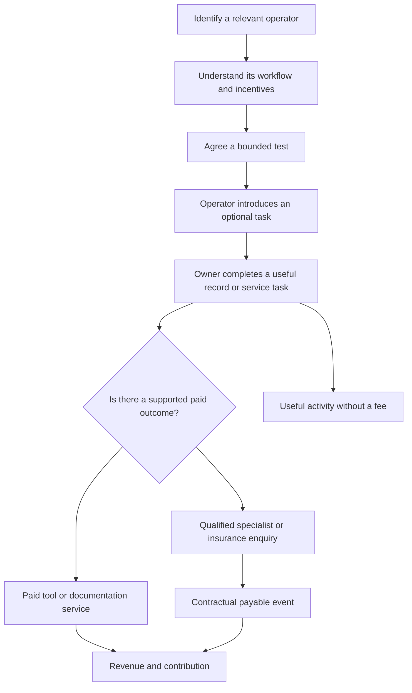

# Objais Networks Groups and Community Distribution

**13 October 2026 | Optional future TCG/community venue research; current Objais products remain the acquisition priority**

Trading card communities are an optional future [acquisition](<Objais Glossary.md#acquisition>) route in the Objais research. A group administrator, store, seller or auction organiser may bring together people who repeatedly buy, sell and exchange cards. The [opportunity](<Objais Glossary.md#opportunity>) is to find a useful place in that existing activity: preparing a listing, recording an acquisition, updating a collection or seeking a supported specialist service.

The user's observation is that many Brazilian [TCG](<Objais Glossary.md#trading-card-game-tcg>) exchanges and auctions happen through groups where owners promote cards. Public examples support the existence of that model, without establishing its national transaction volume or the economics available to Objais. Candidate workflows below are proposed research; they are not existing Objais features, integrations or partnerships. Physical cards remain separate from digital games such as Pokémon TCG Pocket.

## Position in the current plan

Start with existing valuables, car, boat and pet offers, collection management and specialist introductions. TCG venues may later introduce a relevant current offer; the card-specific workflows below are future product hypotheses. This document does not establish card recognition, grading, transaction imports, seller tooling or locally available card insurance. It does not add an active fifth pilot to the original experiments.

[Current media routes, prices and requirements](<Objais Advertising Prices and Requirements.md>) take priority when choosing initial acquisition tests. Optional group discovery should not block a campaign for an existing serviceable product.

For a short explanation of unfamiliar terms, use [the shared glossary](<Objais Glossary.md>). Detailed workflows and counting rules remain in this reference.

## Separate the network from the community and its organiser

The research follows four linked records: the [network](<Objais Glossary.md#network>) hosting activity, the [community](<Objais Glossary.md#community>) using it, the [operator](<Objais Glossary.md#operator>) organising it and the [commerce event](<Objais Glossary.md#commerce-event>) creating a possible task. For example, an auction organised by a seller in a WhatsApp group can create a documentation need. These are distinct from Objais’s contractual [payable events](<Objais Glossary.md#paid-event>).

These distinctions change acquisition. Meta [advertising](<Objais Glossary.md#advertising>) buys distribution from the advertising platform. A sponsored post in a Facebook group depends on the group operator and its rules. A seller's invitation after a sale reaches a different audience at a different moment. All three could involve Facebook while having different costs and conversion paths.

| Layer | Example | What to research |
| --- | --- | --- |
| Network | WhatsApp or Facebook | How the invitation reaches the [owner](<Objais Glossary.md#asset-owner>) and how they can use it |
| Community | A local Pokémon group or a specialist collector group | Physical-card focus, participants, activity and audience overlap |
| Operator | Administrator, shop, creator, recurring seller or auction host | Decision authority, trust, incentives and operational workload |
| [Event](<Objais Glossary.md#event>) | An auction closes or a buyer receives a card | The task that is relevant at that moment |
| Owner action | Save the item, confirm its details or request a service | Completed value and effort |
| Commercial outcome | A paid tool purchase or a supported payable enquiry | Actual payment agreement and [contribution](<Objais Glossary.md#contribution>) |

A group owner is not necessarily the owner of the card. A seller can run several groups, and a collector can participate in several. Separate operator, community, asset owner and opportunity records.

## Public examples of connected Brazilian activity

| Public example | What its public page shows | Interpretation limit |
| --- | --- | --- |
| Celadon | Pokémon, Lorcana, One Piece and local-store WhatsApp communities; social accounts; a Liga Pokémon storefront link | An operator's linked channels, not verified audience or sales totals |
| Dona Onça TCG | Auctions through WhatsApp and a website; card details; payment and combined-shipment arrangements | Published workflow, not an audit of successful trades or fulfilment |
| Luan TCG | WhatsApp entry, lot descriptions, bids and payment/shipment; a TikTok link | Advertised organiser workflow; participant and authenticity claims unverified |
| Sorcery Brasil | A Brazilian store directory, collection tools, a Brazil WhatsApp link and an official Discord link | The Discord link is not proof of a separate Brazilian trading server |
| VoltareL | Card-selling and store-coupon links alongside social accounts; profile metadata mentions WhatsApp and Telegram promotions | Promotional relationships are visible; group activity and commercial terms remain unverified |

Sources: [Celadon](https://linktr.ee/celadondptstore), [Dona Onça TCG](https://donaonca.omgtcg.com.br/), [Luan TCG](https://luantcg.com.br/), [Sorcery Brasil](https://sorcery.com.br/), [VoltareL](https://linktr.ee/voltarel_).

Celadon's links illustrate one operator connecting public discovery, several specialist groups and a store presence. Dona Onça's described combined shipping creates another possible task: a collector may acquire several items before receiving a single shipment. An accurate owner record would need to distinguish purchases, custody, dispatch and receipt.

The researched examples establish useful distribution and workflow patterns. They do not establish that any operator endorses Objais, that the cards are authentic, or that insurance for the activity is available.

## How different networks could fit

| Network or setting | Proposed distribution role | Research focus |
| --- | --- | --- |
| WhatsApp groups and communities | Operator introduction, auction follow-up, transaction-specific invitation | Invitation timing, group rules, owner task and support workload |
| Facebook groups | Specialist discussion, listings, exchanges and administrator-approved demonstrations | Which actual groups permit the offer; distinguish group distribution from Meta ads |
| Discord | A defined [channel](<Objais Glossary.md#channel>) for collection tasks, trading discussion or support | Confirm physical-card relevance and whether the server serves Brazil, Portugal or a global audience |
| Telegram | Creator or operator announcements and targeted offers | Verify current destinations and activity; a directory entry is insufficient |
| Instagram, TikTok and YouTube | Public discovery of sellers, creators and demonstrations | Whether viewers progress into the community or a useful owner task |
| Specialist marketplaces and storefronts | Listing, purchase or seller-dashboard entry | Partner access, completed transaction evidence and permitted data reuse |
| Physical shops and events | Introductions at purchases, exchanges, grading submissions or tournaments | Relevant owner tasks, staff effort and known referral identity |

WhatsApp has the clearest directly reviewed Brazilian auction examples in this research. Facebook group commerce follows the user's observation and remains a group-by-group discovery task. Discord and Telegram are candidates requiring exact audience and activity verification. This is an evidence ranking for research access, not a ranking of channel profitability.

League and marketplace pages may contribute pricing context, but a listing price is different from a completed sale price. A public storefront link does not establish an API, integration or licence to reuse transaction data. The public Liga Pokémon and LigaMagic pages returned access errors during this review; their internal activity was not inspected.

## Two connected funnels

There is an **operator [funnel](<Objais Glossary.md#funnel>)** and an **owner funnel**. The first establishes a willing, suitable distribution relationship. The second tests whether the introduction helps owners and produces a commercial outcome.

One activated operator is not one acquired collector, and one group member is not one Objais user. A link forwarded between groups can preserve an original invitation code while changing the immediate source. Report known [attribution](<Objais Glossary.md#attribution>) and unresolved overlap rather than claiming every group's membership as new reach.

## Match the offer to the moment

| Commerce moment | Owner or operator problem to investigate | Candidate Objais task |
| --- | --- | --- |
| Preparing a listing | Repeating card identifiers, variants and condition descriptions | Create a structured card record and reusable listing details |
| Buying or winning an auction | Losing the connection between the lot, payment and collection record | Save a confirmed acquisition with its evidence |
| Waiting for combined shipping | Multiple purchases remain with a seller | Track declared custody and receipt status without implying protection |
| Receiving a card | Condition or contents may differ from expectations | Attach received-condition photos and purchase evidence |
| Exchanging cards | Ownership and records change in two collections | Update outgoing and incoming records with participant-confirmed details |
| Building a valuable collection | Records may be fragmented or incomplete | Prepare documentation for a supported appraisal or insurance enquiry |

These are discovery candidates. Objais has not been shown to support exact TCG recognition, card variants, transaction imports, seller inventory or these fulfilment functions. Verify the minimum deliverable before promoting it. Auction listing images alone cannot establish authenticity, grading, legal ownership or insurer-accepted value.

If a service would require new development, a manual demonstration can test its usefulness before automation. It should clearly identify what the demonstration provides. Collection recordkeeping, authentication, transaction guarantees, shipping protection and collection insurance are different services.

If later product research establishes the task, a future offer could support a collection or acquisition record before any insurance step. Insurance can remain a later optional step when a local partner actually accepts the card category, value, owner and risk. Brazilian TCG placement and payment rights remain unresolved.

## Why the organiser would participate

The operator needs its own reason to support the workflow. Investigate whether it reduces repetitive listing work, makes buyer records clearer, saves post-auction support time, improves repeat sales or earns an agreed [referral fee](<Objais Glossary.md#referral-fee>). An operator interview should test the actual burden and willingness to run the task, rather than infer enthusiasm from group size.

Possible arrangements include a disclosed sponsored demonstration, an agreed owner introduction, a tool provided to a store, or a service the operator purchases. These arrangements change who pays and which costs belong to acquisition versus delivery. They do not automatically create an Objais fee on each card sale.

An operator's commercial relationship and an owner's insurance relationship require separate payment records. Record any partner compensation once, whether it is a fixed campaign fee, a referral payment or a [revenue](<Objais Glossary.md#revenue>) share.

## Metrics for communities and auctions

The initial 38-metric dictionary still covers the main owner funnel. Add a separate community view with the following proposed measures; they have not been instrumented or added to the original workbook.

| Measure | Definition and counting rule |
| --- | --- |
| Operator [activation](<Objais Glossary.md#activation>) | Operators that execute an agreed introduction or workflow divided by suitable operators with an agreed test |
| Active distribution relationships | Distinct operators actually producing invitations or owner tasks in a stated window |
| Event opportunities | Eligible completed purchases, exchanges or auction outcomes that could receive the invitation; use operator records where available |
| Invitation delivery | [Documented](<Objais Glossary.md#documented>) invitations sent or made available; distinguish actual delivery from reported group membership |
| Useful task completion | Owners or observable journeys completing the defined recordkeeping or service task; label the unit |
| Acquisition evidence completeness | Completed records containing the defined card identity, variant, condition and acquisition evidence |
| Full [owner CAC](<Objais Glossary.md#acquisition-cost-cac>) | Attributable operator recruitment, promotion, onboarding and coordination cost divided by newly identified distinct owners |
| Commercial yield | Qualified and payable outcomes from the [owner cohort](<Objais Glossary.md#cohort>), under the relevant agreement |
| Operator workload | Minutes and cost spent introducing the task and helping each event or owner |
| Concentration and continuation | Share of acquired owners from the largest operator; relationships still producing useful outcomes in later windows |

Illustrative acquisition arithmetic: R$200 of operator recruitment and onboarding, R$100 of promotion and R$100 of coordination produce 40 newly identified owners. Full acquisition cost is R$400 and CAC is **R$10 per owner**. A free group post does not make the route free. If the 40 records are visits rather than distinct new owners, label the R$10 as cost per recorded visit instead of owner CAC. These inputs are invented.

To evaluate contribution, also obtain actual net fees or tool payments, [qualification](<Objais Glossary.md#qualification>), [payable yield](<Objais Glossary.md#payable-yield>) and delivery costs. Group member counts, bids and card sale prices cannot fill those inputs. Keep group, event, asset, transaction, owner and Objais opportunity identifiers separate.

## User experience in a group context

The entry point should retain the task context: which card or collection is involved, why the owner was invited, what information they must confirm and what happens afterward. Test whether an optional post-purchase link or a structured record export is useful, and whether requiring an installation creates unnecessary abandonment.

Give the owner control over providing their own evidence. A screenshot of a conversation may expose other people and unrelated information; structured fields or cropped records may better fit the task. An administrator's agreement to introduce Objais does not give access to members' personal records.

The prototype should explain that an operator introduction is different from an authenticity guarantee or insurance cover. It should also separate a completed purchase from payment, seller custody, shipment and receipt. Include private collection records and controlled sharing in the task tests.

## An optional future Brazilian community pilot

Research a small mix of operators, for example an auction organiser, a physical shop with a WhatsApp group and a collector-run exchange community. Begin with adult owners of physical cards and one precisely defined task. These are recruitment targets, not obtained relationships.

First observe the current workflow with the operator's agreement and participant-provided records. Identify the repeated task, existing alternatives, effort, invitation opportunities and data requirements. Then demonstrate the candidate task using safe test data. Confirm that the operator and owner can use it independently.

If those checks support a pilot, agree a bounded introduction across a stated set of commerce events. Measure useful task completion, owner and operator effort, attributable cost and any supported paid outcome. Group activity is clustered around operators and events; a small pilot is directional and cannot establish national [adoption](<Objais Glossary.md#adoption>) or insurance conversion.

Keep the Brazilian community task separate from the first Portuguese insurance acquisition comparison. BRL costs, local demand and possible collection-tool payments need their own case. If Brazilian TCG insurance is unavailable, the insurance funnel cannot be counted as a successful revenue route; a useful recordkeeping task still needs a supported payment model to become a business.

## Evidence to collect from each operator

Record game and physical-card scope, community type, networks used, audience location, relevant events, observed cadence, group rules, operator authority, current alternatives, introduction terms, invitation denominator, cohort outcomes, support time and costs. Member totals can be retained as descriptive context with source and date, but must not become unique owner reach or completed transactions.

Keep actual sale prices separate from advertised prices, bids, cancelled auctions and unpaid outcomes. For a record transferred between seller and buyer, preserve the change in ownership instead of adding the card twice to one owner's portfolio. Review information supplied for the task without harvesting private member lists or messages.

The [community source register](<research/acquisition/community-sources.csv>) records the reviewed public examples and their limits. The [central acquisition guide](<Objais Acquisition Numerical Summary.md>) connects this distribution route to the broader business model, and the [advertising platform research](<Objais Advertising Platforms Research.md>) retains the paid-channel comparison.
