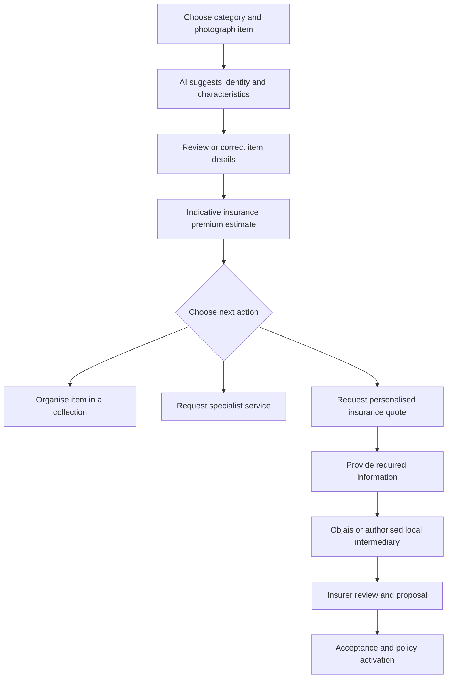

# Objais Company Products and How They Work

**Public research report | 13 October 2026 | English**

Objais combines a mobile app for recognising and organising possessions with an insurance enquiry channel. Its main proposition is a free, indicative insurance premium estimate from a photograph, advertised as taking about 30 seconds. The estimate precedes a personalised quotation and any insurance contract. The company also connects users with specialists who help manage valuable assets. [Objais homepage](https://objais.com/en)

The central distinction is between **identifying an object**, **estimating its value**, **estimating the cost of insurance**, and **obtaining insurance cover**. These are different outputs, with different information requirements. Objais makes the initial enquiry easier; the regulated insurance process continues afterward.

This report covers the company, its products, user journeys, described technology, partner services, commercial model, public rollout, and material inconsistencies. “Advertised” means described by the company; “observed” means present in a public listing or record; analytical explanations and illustrative examples are labelled. Public research cannot establish private financials, proprietary implementation, or actual app performance. No insurance was purchased and the mobile app was not tested.

# Company identity and background

## Legal entity and location

| Field | Publicly stated information |
| --- | --- |
| Brand | OBJAIS; the legal notice says it is a registered trademark of Quotinsure |
| Operating company | Quotinsure Mediação de Seguros, Unipessoal Lda |
| Jurisdiction and form | Portugal; a single member private limited company |
| Tax identifier | NIPC / NIF 519089294 |
| Stated share capital | €5,000 |
| Registered office | Avenida Cerro da Vila, Edifício Vilamarina, Loja 59, 8125-403 Quarteira, Portugal |
| Public contact location | Vilamoura, Portugal |
| Stated insurance registration | ASF number 426595742 |
| Professional liability insurance | The legal notice identifies AIG Europe S.A., policy PTEO000002 |
| Stated hosting | AWS in Europe |

Sources: [Legal notice](https://objais.com/en/legal-notice), [Google Play developer information](https://play.google.com/store/apps/details?id=com.objais.app&hl=en), and [Contact page](https://objais.com/en/contact).

The corporate directory Racius corroborates the tax number, address and capital. Its event history lists incorporation in November 2025 and later corporate acts in February 2026. This is a secondary directory, not a certified commercial registry extract. Share capital is neither the startup’s funding total nor its valuation. [Racius company entry](https://www.racius.com/quotinsure-mediacao-de-seguros-unipessoal-lda/)

## Regulatory evidence

An ASF bulletin dated **19 May 2026**, page 2, lists Quotinsure under **“Inscrição de agentes de seguros”**, with number **426595742**, branches **life and non-life**, and registration date **10 April 2026**. The company’s website instead describes its category as an insurance broker. The bulletin confirms a historical registration but does not settle the company’s current category or territorial permissions. A current ASF register extract is needed to reconcile the terminology. [ASF authorisations and registrations bulletin](https://www.asf.com.pt/documents/42559/4401655/Autoriza%C3%A7%C3%B5es%2Be%2Bregistos%2B19-05-2026%2BSITE.pdf/72d9c6a1-454e-f022-7a0f-84d61d507c00?download=true&version=1.0)

AIG’s appearance in the legal notice concerns the intermediary’s professional liability insurance. It does not establish that AIG underwrites every policy offered through Objais.

## Team and public identities

Objais says it was developed in Portugal and Brazil by an interdisciplinary team comprising insurance veterans, machine learning engineers and art expertise. It does not present a complete named leadership roster on its About page. [About Objais](https://objais.com/en/about-us)

Its LinkedIn page describes a privately held company headquartered in Faro with a **2–10 employee** size band and lists Lucas Nicéas among associated employees. This is a company profile, not audited headcount. [Company LinkedIn page](https://pt.linkedin.com/company/objais)

Apple shows **Christophe Antone** in provider fields. This does not establish a founder or executive role. [Apple listing](https://apps.apple.com/pt/app/objais-seguro-por-foto/id6749889162)

No reliably documented funding round, investor roster, ownership table, revenue figure or profitability figure was established in the reviewed public sources. Objais has an investor enquiry page, but an invitation to invest is not evidence of completed fundraising. [Investor page](https://objais.com/en/investors)

# Product portfolio

Objais calls its audience segments “cabins”. The public pages describe one app serving three audiences; they do not establish three separately downloadable applications. [Homepage](https://objais.com/en)

| Product | Intended users | Advertised scope | Status on 13 October 2026 |
| --- | --- | --- | --- |
| Objais Select | Collectors and owners of valuable assets | Fine art, yachts and superyachts, watches, jewellery, luxury handbags and supercars; recognition, premium estimates, collections and specialist access | Advertised as available |
| Objais Family | Households and owners of everyday premium assets | Cars, leisure boats, collections and pets; the product page also lists family health and home and contents | Advertised as live; health and home availability requires clarification |
| Objais Business | Businesses and self-employed people | Professional liability, fleets, group health, SME multi-risk and dedicated account management | Planned for end of 2026; waitlist offered |

Sources: [Select](https://objais.com/en/select), [Family](https://objais.com/en/family), and [Business](https://objais.com/en/business).

## Objais Select

Select is the clearest expression of the original collector proposition: photograph an asset, identify it, obtain an initial premium estimate, organise it in a collection, and request further assistance when needed. Its advertised asset categories make specialist knowledge relevant to recognition, appraisal, underwriting and care. The page’s older “supercars in July” wording remains alongside descriptions that include supercars. [Select product page](https://objais.com/en/select)

**Illustrative use:** a watch owner could use Select to catalogue a piece, check an initial insurance cost and request a specialist quotation. The photograph alone should not be treated as proof of authenticity, ownership, servicing history or an insurer-approved value.

## Objais Family

Family broadens the proposition from collecting to household possessions and pets. Its product page includes health and home insurance, but the insurance page describes health and home as forthcoming. These categories should be treated as advertised scope rather than confirmed availability in every country. [Family product page](https://objais.com/en/family), [Insurance page](https://objais.com/en/insurance)

The practical appeal is a low effort starting point for considering insurance. For non-visible risks such as medical history, property exposure or liability, additional information is still needed to determine suitable cover.

## Objais Business

Business is an announced expansion into commercial insurance, including fleets, liability, group health and SME multi-risk. Dedicated account management is part of its advertised offer. A waitlist and end-of-2026 launch message do not establish general production availability. [Business product page](https://objais.com/en/business)

**Analytical implication:** a photograph may help identify a vehicle or physical asset, but cannot establish a business’s turnover, activities, claims history, employee population or contractual liabilities. The commercial journey would therefore need a structured information stage beyond the image. The public page does not explain that stage.

# How the app and insurance journey work

## From photograph to initial estimate

The public screens depict category selection, AI matches, confirmation of item details and a collection overview. Objais describes recognition, assessment of visible characteristics and a premium estimate. Its collection workflow allows identified objects to be organised and shared or kept private. [How it works](https://objais.com/en/how-it-works), [Homepage screen descriptions](https://objais.com/en)

An artwork photography guide adds that the user can edit the information gathered by AI and then request an insurance estimate. It recommends diffuse lighting, a camera parallel to the work and inclusion of relevant edges and identifying details. This suggests that some journeys involve identification and user confirmation before the premium calculation, even though the main marketing reduces the experience to one photo. [Photography guide](https://objais.com/en/blog/how-to-photograph-art)

The diagram is a synthesis of the described journey, not a verified sequence of app screens. Specialist services have their own agreements and delivery processes.

## Four outputs that should be distinguished

| Output | Question answered | Practical limit |
| --- | --- | --- |
| Recognition result | What might this object be? | A visual match can need correction or authentication |
| Reference valuation | What might the object be worth? | An AI value is not a certified appraisal |
| Premium estimate | What might insurance cost? | Indicative; does not activate cover |
| Formal quotation and policy | What cover is offered, on what terms? | Requires personalised information and the applicable acceptance process |

Objais’s luxury asset guide explicitly distinguishes its AI valuations from certified appraisals and insurance valuations. Its terms place formal proposals with Objais or authorised partners. [Luxury asset guide](https://objais.com/en/blog/insuring-luxury-assets-guide), [Terms](https://objais.com/en/terms)

## From estimate to cover

The next step is optional: the user requests a personalised quote. The intermediary gathers the information needed for the proposal and insurer review. Actual activation can require an expert assessment and insurer acceptance, depending on asset, country and value. The advertised 30-second turnaround applies to the initial estimate. [FAQ](https://objais.com/en/faq)

**Illustrative example:** if an app displays a yearly premium estimate of €400, that figure is an enquiry starting point. A later proposal may have a different premium, deductible, insured value, exclusions and geographic scope. The €400 figure is invented for explanation and is not an Objais tariff.

The reviewed pages do not establish a universal instant checkout, payment process, claims workflow or policy activation time. These details must be checked in the actual offer for the relevant country.

# How the products work for different assets

## Watches and other collectibles

Objais’s watch guide describes uncertified AI reference valuations using auction databases and market platforms, followed by access to specialist insurance partners. It also describes optional alerts when collection values move significantly. [Watch collection guide](https://objais.com/en/blog/insuring-watch-collection)

**Illustrative workflow:** photograph a watch, review the model match, organise the item, request an estimate, then pursue a quotation. A specialist may need documentation beyond what the image shows. A similar sequence is plausible for handbags, jewellery and art, but category-specific requirements vary.

## Fine art

The company’s AI valuation article describes three stages: visual identification of work, artist and period; comparison with market transactions and history; and a reference value that the user can adjust. Rare or contextual works may need professional appraisal. [AI art valuation article](https://objais.com/en/blog/ai-valuation-for-art-collectors)

**Analytical limitation:** recognising a signature or style does not authenticate a work. Provenance, hidden damage, attribution and restoration can materially affect value. This explains why specialist appraisal remains a separate service.

## Dogs and cats

An October 2026 product article explains the pet journey more concretely. The AI recognises species and likely breed from a photo, provides an initial estimate, and passes the user to an intermediary if they want to continue. Age, history and cover level enter the later discussion. The article highlights reimbursement limits, reimbursement percentages, deductibles and waiting periods as plan details to examine. [Pet product explanation](https://objais.com/en/blog/pet-insurance-dog-cat-photo)

**Analytical limitation:** the image is an identification shortcut, not a veterinary history. The final plan depends on information and terms beyond visible breed characteristics.

## Cars and yachts

Both are prominent advertised categories. A photo can initiate identification and a cost enquiry; it does not determine all underwriting factors. Vehicle usage, driving history, marine navigation area, maintenance and surveys are examples of factors that may matter in a personalised insurance process. These are analytical examples, not a disclosed Objais questionnaire. [Insurance categories](https://objais.com/en/insurance)

# Technology and information flow

## What Objais describes

The company calls its recognition technology proprietary and says premium estimates use market information from auction houses, dealers and insurers. Its art article claims training on decades of auction, dealer and appraisal records, and says image processing takes place on the device where technically feasible. It also claims typical reference valuations within **10–20%** of actual market value for “standard works”. No evaluation dataset, sample size or independent benchmark accompanies that figure in the article. [How it works](https://objais.com/en/how-it-works), [AI art valuation article](https://objais.com/en/blog/ai-valuation-for-art-collectors)

That percentage concerns an advertised asset valuation capability; it should not be read as a measured error rate for insurance premiums across cars, yachts, pets and every other category.

## Logical architecture inferred from the product

The following components are an analytical decomposition of the described behaviour, not a disclosure of the actual software architecture:

1. **Image input:** camera capture or photo submission, associated with an asset category.
2. **Recognition:** candidate identity and visible attributes, followed by correction when necessary.
3. **Reference information:** comparable objects or transactions used to contextualise the item.
4. **Estimation:** an indicative premium based on the available asset information and assumptions.
5. **Collections:** persistent item records, organisation and visibility controls.
6. **Requests:** service selection, personalised information collection and local partner routing.
7. **Regulated fulfilment:** intermediary handling, insurer review and contractual insurance terms.

This decomposition explains how the product could connect recognition to distribution. It does not identify a particular vision model, LLM, retrieval framework, database or pricing algorithm.

## Technical details that remain undisclosed

The reviewed sources do not identify the underlying model vendors, model sizes, training rights, dataset coverage, confidence thresholds, failure handling, pricing formula or category-specific assumptions. They also do not explain cloud versus device processing for every feature, encryption key management, or a public API specification.

A useful demonstration would show an unfamiliar item, an ambiguous photo and an incorrect match; how the user corrects the result; which assumptions appear beside the estimate; and how the system declines to price an unsupported case.

# Collection management and sharing

Collections provide a continuing use for the app after the first estimate. Objais describes catalogues of art, watches, jewellery, handbags and vehicles, with organisation and optional sharing. [How it works](https://objais.com/en/how-it-works)

The terms indicate that some features require accounts and recommend pseudonyms. Published collection content is subject to moderation; users choose public or private status. Collection uploads carry a broad licence for use within the application. Photos submitted only for an estimate or quote are treated separately and are not made public. [Terms sections 3, 6 and 8](https://objais.com/en/terms)

The FAQ describes optional market updates and alerts. An updated estimate does **not** amend an existing policy’s insured amount: the user must request an insurance update separately. [FAQ on updates](https://objais.com/en/faq)

**Analytical implication:** owners should distinguish a collection’s current app value from the insurer’s agreed insured amount. A rising reference value can highlight a need for review without itself changing contractual protection.

# Services beyond insurance

Objais advertises introductions to independent specialists. Access through the app is separate from the specialist’s work and agreement. [Services overview](https://objais.com/en/services)

| Service | Advertised function |
| --- | --- |
| AI virtual exhibitions | Immersive video settings for presenting works, with private or public sharing |
| Expertise and valuation | Reports, valuations, provenance research, due diligence, certificates and art advisory access |
| Legal and consultancy | Purchase and financing contracts, tax, inheritance and art business structuring |
| Transport and storage | Art logistics, international transport, crating, climate-controlled storage and inventory |
| Insurance organisation | Portfolio and policy tracking alongside estimates |

The services page marks access as “Included” across cabins, without establishing free professional work. Blockchain certificates are mentioned without a technical specification. [Services](https://objais.com/en/services)

The partnership page expands the specialist menu by asset: restoration and authentication for art; maintenance and surveys for yachts; detailing and concierge for vehicles; servicing for watches; and cleaning, restoration and certification for jewellery and bags. [Partnership categories](https://objais.com/en/strategic-partnerships)

**Interpretation:** the “one app” proposition concerns access and coordination. It does not establish that Objais itself performs every appraisal, restoration, legal assignment or shipment.

# Partner network and geographic reach

Objais describes a partner portal, optional API integration and no upfront access costs. Partners can select requests in their country and specialty and perform work autonomously on their own terms. The page claims access to users in more than 50 countries, but does not name a complete country-by-country network. [Strategic partnerships](https://objais.com/en/strategic-partnerships)

The investor page calls the distribution layer **Objais Partners**. It says qualified leads go to locally licensed intermediaries and that responsiveness, service quality and satisfaction determine lead exclusivity. No published routing algorithm, exclusivity contract or service-level schedule was established. [Investor description](https://objais.com/en/investors)

App availability, estimate availability and ability to place a policy are three different geographic questions. A user in Brazil, for example, should confirm the responsible local entity and product availability rather than infer insurance placement rights from the company’s Brazilian development roots.

The website refers to specialty insurers and carriers rated A, without providing a complete insurer list or identifying the rating agency for every carrier. Those references do not establish a universal counterparty quality level for every offer. [Homepage](https://objais.com/en)

# Pricing and business model

The basic app and initial estimate are advertised as free. The FAQ says the main revenue comes from insurer-paid commissions, with additional referral fees paid by specialist providers. It says Objais does not mark up those providers’ prices. Commission rates, fee schedules, partner revenue splits and commercial volumes are not publicly detailed. [Download page](https://objais.com/en/download), [Revenue explanation](https://objais.com/en/faq)

The terms mention paid plans, but the reviewed pages do not present a complete current subscription schedule. It would be inaccurate to conclude that every feature and service is permanently free. [Terms](https://objais.com/en/terms)

**Business analysis:** the model appears to use the initial estimate as an acquisition channel. An owner can explore cost without completing a full application; an interested owner then becomes a request for the intermediary network. Collections may support repeat engagement, and specialist requests provide an additional source of commercial value.

This model’s economics depend on more than download volume: estimate-to-request conversion, partner response, quote-to-policy conversion, commissions, retention and service referral revenue all matter. None can be calculated responsibly from the available public figures.

# Privacy security and account lifecycle

The privacy policy, version 1.3 dated **2 July 2026**, distinguishes an estimate-only photograph from personalised service and account data. Photos and metadata may themselves be personal data. Estimate-only data is deleted or anonymised afterward; requests can involve identity, contact and asset information. Hosting is stated to be in the EU, with safeguards for transfers outside it. Partner intermediaries may act as independent controllers. The policy says request transmission rests on contract or pre-contractual processing, rather than consent. It also says the mobile app uses no tracking tools. [Privacy policy](https://objais.com/en/privacy)

The policy lists retention of client data for the relationship plus five years and leads for 12 months. Inactive accounts can be deleted after six months, following notification and a 30-day reactivation window. It sets an 18-plus intended audience. [Privacy policy](https://objais.com/en/privacy)

Public declarations need reconciliation:

- Apple’s developer-supplied label lists possible identifier and usage tracking. [Apple privacy label](https://apps.apple.com/pt/app/objais-seguro-por-foto/id6749889162)
- Google’s developer-supplied label says no third-party sharing, describes personal information and identifiers, and confirms encryption in transit. [Google data safety](https://play.google.com/store/apps/details?id=com.objais.app&hl=en)
- Marketing claims end-to-end encryption and purpose-specific consent for sharing. These declarations do not, by themselves, demonstrate key management or rule out server-side processing. [How it works](https://objais.com/en/how-it-works), [FAQ](https://objais.com/en/faq)

Encryption in transit, encryption at rest and end-to-end encryption are distinct properties. The labels and marketing text are not an independent security audit.

# App availability and public rollout

## Distribution

The iOS app ID is **6749889162**, requiring **iOS 15.5+**. Android uses **com.objais.app**. The website instead states iOS 15.0+, plus Android 10+ and ARCore compatibility; Android hardware requirements were not tested. [Apple listing](https://apps.apple.com/pt/app/objais-seguro-por-foto/id6749889162), [Google listing](https://play.google.com/store/apps/details?id=com.objais.app&hl=en), [Website requirements](https://objais.com/en/download)

## Release history and plans

| Date shown | Public milestone | Evidence |
| --- | --- | --- |
| November 2025 | Corporate directory lists incorporation | Racius |
| 10 April 2026 | Historical intermediary registration | ASF bulletin |
| 1 May 2026 | v1.2.0: guest requests | Apple |
| 3 July 2026 | v2.1.0: handbags | Apple |
| 6 August 2026 | v2.2.0: cars | Apple |
| 22 September 2026 | v2.3.0: pets | Apple |
| Observed at review | v2.3.7: Apple sign-in | Apple; relative date not used |
| 7 October 2026 | Android listing update date | Google Play |
| 9–12 November 2026 | Company says it will attend Web Summit in Lisbon | Objais investor page; future plan |
| End of 2026 | Business launch target | Business page; future plan |

Sources: [Racius](https://www.racius.com/quotinsure-mediacao-de-seguros-unipessoal-lda/), [ASF bulletin](https://www.asf.com.pt/documents/42559/4401655/Autoriza%C3%A7%C3%B5es%2Be%2Bregistos%2B19-05-2026%2BSITE.pdf/72d9c6a1-454e-f022-7a0f-84d61d507c00?download=true&version=1.0), [Apple](https://apps.apple.com/pt/app/objais-seguro-por-foto/id6749889162), [Google](https://play.google.com/store/apps/details?id=com.objais.app&hl=en), [Investors](https://objais.com/en/investors), [Business](https://objais.com/en/business).

The release sequence is stronger evidence of category rollout than undated marketing promises. It still does not prove that every category works in every jurisdiction.

# Public traction and external coverage

At review, Google Play showed **50+ downloads**, Apple Portugal **5.0 from four ratings**, and LinkedIn roughly **213 followers**. These are platform-specific signals, not total customers or policies. [Google Play](https://play.google.com/store/apps/details?id=com.objais.app&hl=en), [Apple Portugal](https://apps.apple.com/pt/app/objais-seguro-por-foto/id6749889162), [LinkedIn](https://pt.linkedin.com/company/objais)

A **15 July 2026** article by Jean-Philippe Tarot in Montres-de-luxe.com discusses Objais’s watch collector proposition, photo estimates, collections and related services. It establishes relevant specialist press attention. Its security and accuracy descriptions are not accompanied by an independent technical test, so it should not be used as audit evidence. [Montres-de-luxe article](https://www.montres-de-luxe.com/Objais-l-intelligence-artificielle-au-service-des-collectionneurs-de-haute-horlogerie_a21719.html)

The available public material does not establish active users, policies sold, premium volume, assets under management, conversion rates, customer acquisition cost or renewal performance. Download bands and social followers cannot substitute for those measures.

# Inconsistencies that affect product understanding

| Issue | Evidence and interpretation |
| --- | --- |
| Broker versus agent | Website uses broker terminology; the historical ASF record places Quotinsure among agents. Current classification needs confirmation. |
| Health and home availability | Family lists these categories; the insurance page calls them forthcoming. Treat availability as unresolved. |
| Version and pet launch timing | Website v2.2.0 notes associate pets with August; Apple associates them with September v2.3.0. Prefer platform history. |
| Tracking | The privacy policy says no app tracking tools; Apple’s label lists possible tracking. Technical and policy reconciliation is needed. |
| Sharing and consent | Marketing frames sharing as consent-based; the policy describes necessary request transfers on a contractual basis. Distinguish user initiation from the stated legal basis. |
| Marketplace terminology | Investors call the partner distribution layer a marketplace; the terms say Objais is not a marketplace. This may reflect a commercial metaphor, but the roles should be clarified. |
| Services marked included | Access is listed across cabins; professional service prices and entitlements remain unspecified. |

Supporting sources: [Legal notice](https://objais.com/en/legal-notice), [ASF bulletin](https://www.asf.com.pt/documents/42559/4401655/Autoriza%C3%A7%C3%B5es%2Be%2Bregistos%2B19-05-2026%2BSITE.pdf/72d9c6a1-454e-f022-7a0f-84d61d507c00?download=true&version=1.0), [Family](https://objais.com/en/family), [Insurance](https://objais.com/en/insurance), [Download](https://objais.com/en/download), [Apple](https://apps.apple.com/pt/app/objais-seguro-por-foto/id6749889162), [Privacy](https://objais.com/en/privacy), [Investors](https://objais.com/en/investors), [Terms](https://objais.com/en/terms), [Services](https://objais.com/en/services).

These differences are reasons to ask precise questions. They do not, alone, establish misconduct or technical failure.

# Assessment of the product and business

**Analysis:** Objais addresses a concrete point of friction: owners often want an initial cost indication before committing time or disclosing detailed personal information. A photograph offers a familiar entry point, particularly for possessions that can be visually identified. Collection management gives the app a continuing role beyond a single insurance enquiry.

The strongest potential differentiation lies in the connection between identification, useful estimates and dependable local fulfilment. A recogniser alone is easier to imitate than a system that handles ambiguous objects, communicates assumptions, routes requests promptly and converts them into suitable policies or specialist work.

The central product challenge is maintaining trust when the later quote differs from the initial estimate. An attractive estimate can encourage exploration, but poor calibration can create disappointment and unproductive leads. A useful evaluation should measure the gap between estimated and quoted premiums by asset category and jurisdiction, alongside completion rates and partner response times.

Expansion has different information costs. Art and watches have market reference problems; pets require medical and plan details; commercial liability depends heavily on facts that a photo cannot reveal. Reusing the same entry gesture does not mean the same estimation logic is sufficient for every product.

The public rollout indicates an evolving app and widening scope. It does not yet supply the operational and financial measures needed to judge whether the distribution model scales profitably. Partner quality, data rights, estimate calibration, privacy implementation and renewal performance would be the most informative next evidence.

# Questions for a company demonstration or diligence meeting

| Area | Questions that would resolve the main uncertainties |
| --- | --- |
| Company and governance | Who are the founders, directors and beneficial owners? What funding has closed, and what does the current ownership table show? |
| Regulatory scope | What is the current ASF category? Which entity handles each country? Can registrations and insurer mandates be provided? |
| Product availability | Which categories and services are live in each market? Are health and home live? What will Business launch with? |
| Estimate quality | How do estimates compare with final quotes? Which assumptions, confidence indicators and rejection rules are used? |
| Recognition and appraisal | How are ambiguous or counterfeit items handled? What evidence is needed for a certified valuation? |
| Data and models | What models and licensed datasets are used? What runs on the device? Are customer images used for training? |
| Privacy and security | Why do privacy declarations differ? Who can decrypt photos? What deletion, backup and audit evidence exists? |
| Partners | Which insurers and specialists are active? What are routing, exclusivity, response and complaint arrangements? |
| Pricing | Which features require payment? What commissions and referral fees apply? Are specialist charges shown before commitment? |
| Insurance lifecycle | How do acceptance, payment, documents, claims, cancellations and renewals work in the app and with partners? |
| Business performance | What are active users, qualified requests, bound policies, premium volume, retention and unit economics? |

A useful demonstration should follow one request from photograph to corrected identity, estimate, personalised proposal and policy record. It should also show an unsupported asset and a user declining to continue.

# Contact details and source directory

Public business contacts are **contact@objais.com**, **support@objais.com**, and **+351 966 698 860**. The website offers general and partnership enquiry forms and advertises a response within 24 hours; that is a stated target, not an observed service level. [Contact page](https://objais.com/en/contact), [Google developer contact](https://play.google.com/store/apps/details?id=com.objais.app&hl=en)

The following sources were reviewed on 13 October 2026. Where web extraction failed, the public HTML or ASF PDF was read directly. Pages and store listings can change; the ASF bulletin is a historical record.

| Source group | Links | Main use |
| --- | --- | --- |
| Company and core proposition | [Homepage](https://objais.com/en), [About](https://objais.com/en/about-us), [Contact](https://objais.com/en/contact) | Identity, positioning and contacts |
| Product pages | [Select](https://objais.com/en/select), [Family](https://objais.com/en/family), [Business](https://objais.com/en/business) | Audiences, categories and status |
| Product operation | [How it works](https://objais.com/en/how-it-works), [Insurance](https://objais.com/en/insurance), [FAQ](https://objais.com/en/faq) | Estimate, quotation and updates |
| Ecosystem | [Services](https://objais.com/en/services), [Partnerships](https://objais.com/en/strategic-partnerships), [Investors](https://objais.com/en/investors) | Service scope and distribution |
| Legal documents | [Legal notice](https://objais.com/en/legal-notice), [Terms](https://objais.com/en/terms), [Privacy](https://objais.com/en/privacy) | Entity, obligations and data handling |
| Distribution | [Website download](https://objais.com/en/download), [Apple Portugal](https://apps.apple.com/pt/app/objais-seguro-por-foto/id6749889162), [Google Play](https://play.google.com/store/apps/details?id=com.objais.app&hl=en) | Releases, availability and declarations |
| Product explanations | [AI art valuation](https://objais.com/en/blog/ai-valuation-for-art-collectors), [Photography](https://objais.com/en/blog/how-to-photograph-art), [Watches](https://objais.com/en/blog/insuring-watch-collection), [Luxury assets](https://objais.com/en/blog/insuring-luxury-assets-guide), [Pets](https://objais.com/en/blog/pet-insurance-dog-cat-photo) | Category workflows and claim limits |
| Company profile and directory | [LinkedIn](https://pt.linkedin.com/company/objais), [Racius](https://www.racius.com/quotinsure-mediacao-de-seguros-unipessoal-lda/) | Team profile and corporate event history |
| Regulatory record | [ASF bulletin of 19 May 2026](https://www.asf.com.pt/documents/42559/4401655/Autoriza%C3%A7%C3%B5es%2Be%2Bregistos%2B19-05-2026%2BSITE.pdf/72d9c6a1-454e-f022-7a0f-84d61d507c00?download=true&version=1.0) | Historical registration, page 2 |
| Specialist press | [Montres-de-luxe article](https://www.montres-de-luxe.com/Objais-l-intelligence-artificielle-au-service-des-collectionneurs-de-haute-horlogerie_a21719.html) | External coverage dated 15 July 2026 |
