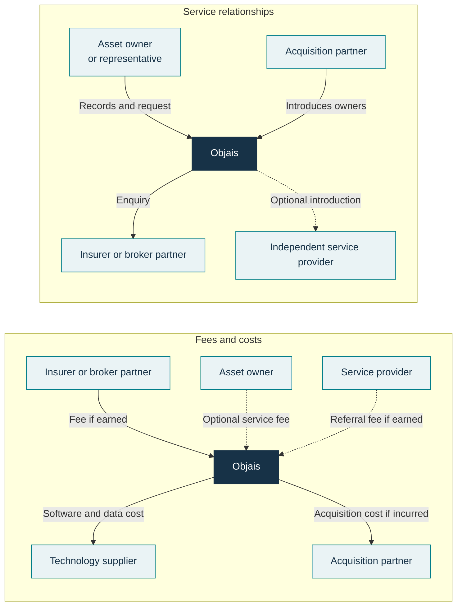
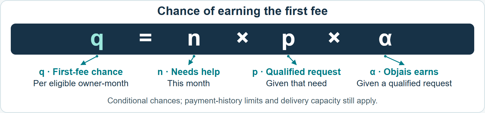
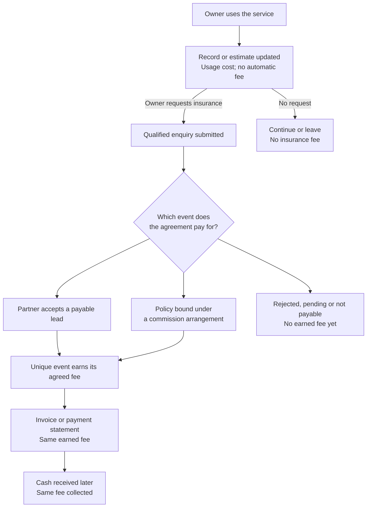
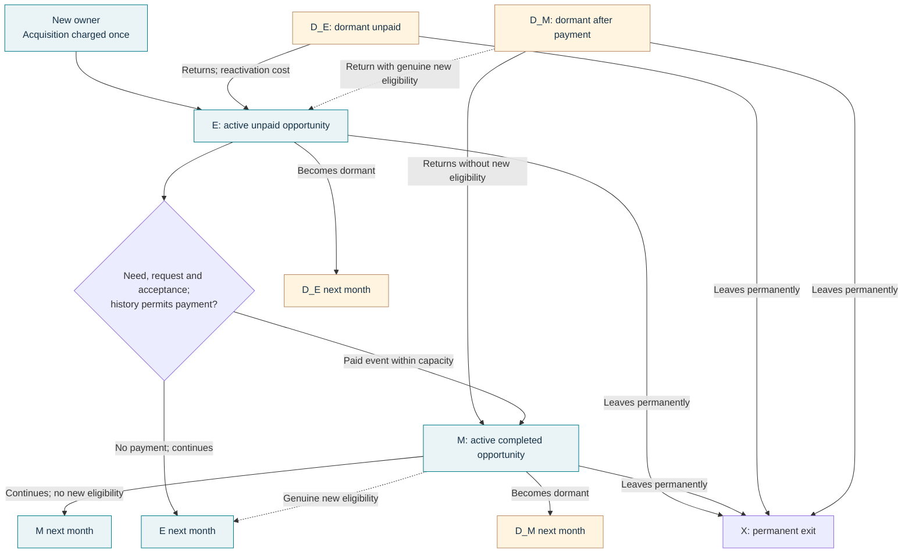
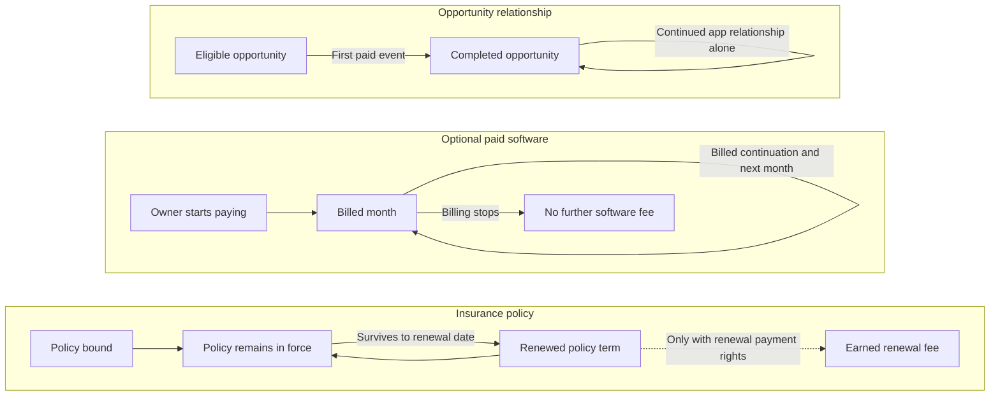
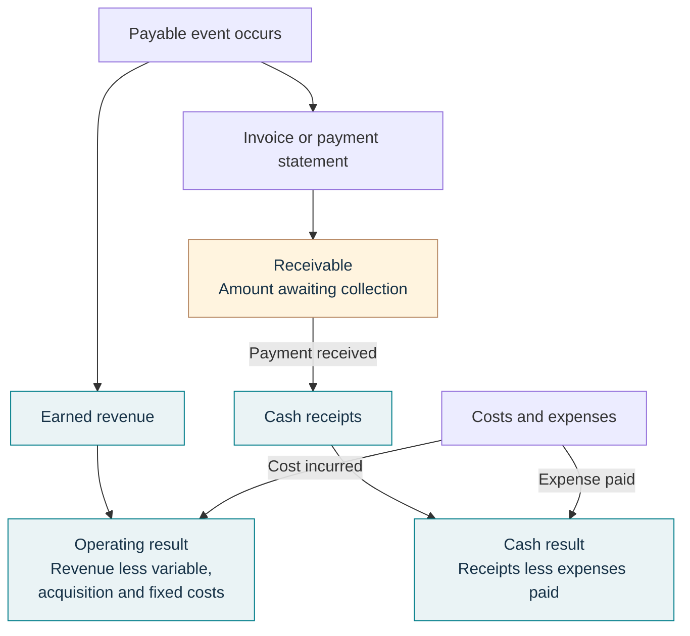
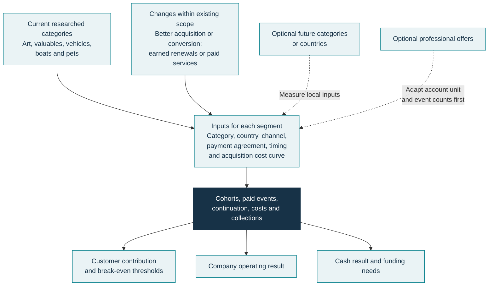

# Objais Revenue Model: What Would Make the Business Work?

**Reviewed 14 October 2026. Numerical inputs are illustrative assumptions, not measured Objais results.**

This analysis tests lead selling as a working baseline. Objais’s [public FAQ](https://objais.com/en/faq) describes insurance-company commissions and specialist referrals; it does not establish the lead-sale contracts or retention rates assumed here. The practical concern is whether a fee covers acquisition and service costs when someone gets what they need and leaves.

An occasional service can still be a good business. People do not have to use it every week for it to be worthwhile. But the money earned from helping them has to cover the cost of finding them, doing the work and running the company.

Collectibles could give people more reasons to return. So could better services for the assets Objais already covers. The important question is what happens on those return visits. More activity might lead to another payment, or it might simply mean more work for Objais.

Once- or twice-yearly insurance need is one scenario explored here, not an observed customer habit. The same caution applies to the idea that frequent buyers of expensive possessions may delegate the work to staff or advisers. Both are reasonable questions to investigate; neither should quietly become a fact in the forecast.

The model connects the person using the service, the payer, the costs and collection dates. Advertised estimate updates and notifications may give people reasons to return, but they do not establish observed retention or another fee.

Unfamiliar terms link to the [shared glossary](<Objais Glossary.md>). The examples can be followed in order without reading it first.

## The people behind the numbers

The consumer examples follow people and their possessions. Someone with three watches and a car is still one [asset owner](<Objais Glossary.md#asset-owner>). In these examples, that person is the customer, including when they use the service for free.

A representative, such as a staff member or adviser, doing the work does not turn one owner into two customers. This matters when comparing people who handle their own possessions with people who delegate.

Reaching 1,000 people and gaining 100 customers is quite different from gaining 1,000 customers. All the spending on reaching them counts when calculating [acquisition cost (CAC)](<Objais Glossary.md#acquisition-cost-cac>) per new owner, including the spending on those who never join. How people arrive and how many join affect that cost.

The people and companies have different roles in the service and its payments:

| Participant | What they do, and where the money fits |
| --- | --- |
| Owner or representative | Provides records and asks for help. The owner pays Objais only for a service sold to them. |
| Objais | Organises the work, passes enquiries to partners and earns agreed fees. |
| Insurer or broker | Evaluates the enquiry and pays when the agreement's conditions are met. |
| Acquisition partner | Introduces people to Objais. Any introduction cost belongs in CAC. |
| Independent service provider | Could provide appraisal or restoration, with a referral payment to Objais if agreed. |
| Technology supplier | Provides software, storage or information, with costs attached. |

The top half shows the service; the bottom half shows the money. The same people appear in both. Dashed lines show possible arrangements, and a fee owed may arrive later. Actual partners and payment terms still need confirmation.

A person, each possession and each request or transaction need separate records. A request can earn a fee only when the agreement’s payment condition is met: the [paid event](<Objais Glossary.md#paid-event>). Otherwise, adding an item or returning to the app can look like another customer or another payment when it is neither.

## When an enquiry actually earns money

In the lead-selling example, Objais passes an insurance enquiry to a partner. The enquiry must meet the agreed requirements, and the partner must accept it as payable before Objais earns its fee. The owner must also still have an opportunity to earn that first fee.

For each such owner, the monthly [payment chance](<Objais Glossary.md#conversion-probability>) combines three steps:

In **q = n × p × α**, acceptance is conditional on a qualified request. A percentage of visitors, requests or owners cannot be substituted without its denominator.

Need can follow a season or the time since a person joined. Payment-history limits and delivery capacity can reduce the number of paid events further.

Some agreements wait until insurance cover becomes effective, at [policy binding](<Objais Glossary.md#policy-binding>). In that case, q is the chance of reaching effective cover. The price paid for insurance is separate from Objais’s commission. A lead fee and a binding commission belong together only if the contract grants separate payments for both.

Objais can earn a fee before receiving it. The amount awaiting payment is a [receivable](<Objais Glossary.md#receivable>); collection later brings in the cash. A withdrawn fee reduces the amount earned. Issuing an invoice or receiving the money does not earn the fee again.

The agreement decides whether the fee is earned when a lead is accepted or cover starts. Both payments belong together only with separate contractual rights. Invoicing and collection follow the fee already earned.

### A simple example

Suppose 1,000 owners join. Each costs €4 to bring in. A 10% payment chance means 100 paid leads are expected, each earning Objais €20. Assume 5% of those fees are later withdrawn or credited back. Processing costs €1 per paid lead, and serving each of the 1,000 owners costs €0.20 for the month. The example leaves out fixed overhead, such as the monthly salaries and rent assumed later.

| What happens in the first month | Amount |
| --- | ---: |
| 100 paid leads × €20 | €2,000 |
| Expected fee reversals | −€100 |
| Processing the 100 paid leads | −€100 |
| Serving the 1,000 owners | −€200 |
| Acquiring the 1,000 owners | −€4,000 |
| **Result after these costs** | **−€2,400** |

After acquisition and service costs, the group’s [contribution](<Objais Glossary.md#contribution>) is −€2,400. The company’s fixed overhead still needs paying.

### Why this is an average loss of €2.40 per owner

Objais earns lead fees for 100 of the 1,000 owners, while acquisition and service costs apply to all 1,000. The €2,400 loss belongs to the whole group. Dividing it by 1,000 gives an **average loss of €2.40 per acquired owner**; it is not the loss on each paid lead.

The calculation is easier to follow in four steps:

1. **A paid lead leaves €18 after fee reversals and processing.** The €20 fee is reduced by an average €1 for reversals and €1 for processing: €20 − €1 − €1 = €18.
2. **Spread over all acquired owners, that becomes €1.80 each.** Only 100 of the 1,000 produce a paid lead: 100 × €18 ÷ 1,000 = €1.80.
3. **Serving each owner costs another €0.20.** That leaves €1.80 − €0.20 = **€1.60 per owner to cover acquisition**.
4. **Acquisition costs €4 per owner.** The result is €1.60 − €4 = **−€2.40 per owner**, before fixed costs.

Only **€1.60 per owner is available for acquisition**, against €4 spent.

### What would have to change to reach zero?

Here, [break-even](<Objais Glossary.md#break-even>) means that the earned fees cover acquisition and service costs, leaving zero contribution per acquired owner before fixed costs. There are several ways to close the €2.40 gap. Each row below changes **one assumption on its own**, leaving the other numbers in this example unchanged.

| Change | A value that reaches break-even | Why it closes the gap |
| --- | --- | --- |
| Cheaper acquisition | CAC falls from €4 to **€1.60 or less** | Acquisition fits within the €1.60 already available per owner. |
| More enquiries earning a fee | The payment chance rises from 10% to **23.34% or more** | More of the 1,000 owners produce paid leads at the same €20 fee. |
| A higher fee | The fee rises from €20 to **€45.27 or more per paid lead** | Each of the same 100 paid leads leaves enough to cover costs across all 1,000 owners. |

The payment chance and fee are rounded upward so the displayed values reach at least zero. These are alternative changes, not three requirements that must all happen together. A mix of smaller improvements could also help.

At zero contribution, there is nothing left for fixed costs. **Covering the cost of acquiring and serving customers is the first hurdle; covering the company's overhead comes after that.**

## What returning customers can change

Follow the same 1,000 owners over time as one [cohort](<Objais Glossary.md#cohort>). Their return visits do not add new owners or another acquisition bill.

[Retention](<Objais Glossary.md#retention>) needs to be measured separately for each relationship. Someone can stop visiting the app while their cover or payments for a separate service continue.

The next example separates owners whose opportunity is [still waiting for its first fee (E)](<Objais Glossary.md#eligible-state-e>) from those whose opportunity has [already earned Objais its fee (M)](<Objais Glossary.md#monetised-state-m>). The diagram also allows owners to go quiet and return: D_E and D_M preserve their unpaid or paid status. X marks a permanent exit from the enquiry relationship.

Each group has a monthly chance of continuing. After a fee has been earned, another fee needs a genuinely new opportunity permitted by the agreement. The [reset rate, λ](<Objais Glossary.md#reset-rate>) controls how often those new opportunities arise; simply adding an item is not enough.

Someone can go quiet and return with the same customer record and payment history. The dashed paths need a genuinely new payable opportunity; returning does not clear payment limits. Insurance cover and software billing can continue separately.

### Another chance at the first payment

For the moment, suppose there is no dormancy or repeat opportunity. Keep the first-month assumptions and let 80% of owners continue each month, both before and after payment. Serving someone whose opportunity has already earned its fee (M) costs €0.30 per month. Set λ = 0, so nobody gains a new payable opportunity and each person can produce at most one paid lead for Objais.

| The same group of people | Month 1 | Month 2 |
| --- | ---: | ---: |
| E owners at the start | 1,000 | 720 |
| M owners at the start | 0 | 80 |
| Paid leads: 10% of E | 100 | 72 |
| Revenue after expected reversals | €1,900 | €1,368 |
| Variable costs | €300 | €240 |
| Acquisition cost | €4,000 | €0 |
| **Contribution before fixed costs** | **−€2,400** | **+€1,128** |

The second month looks better because there is no new acquisition bill for this group. Some people who did not convert the first time now do.

Follow the original group for 36 months with [discounting](<Objais Glossary.md#discounting>) at 1% per month. This weights later results; collection timing is a separate question.

After variable and acquisition costs, but before fixed costs, the result is **+€1.17 per originally acquired owner**, compared with −€2.40 when everyone leaves after the first month. This improvement comes from more first conversions. It does not require another payment for the same lead.

Now change which owners continue: let all owners still waiting for their first fee leave after month 1, and keep only the owners whose enquiries already earned Objais a fee. At 80% continuation, the one-off loss of €2.40 becomes **−€2.51** because service costs continue without another payment. With both groups continuing at 80%, allowing 10% of continuing owners with a completed opportunity to gain a genuinely new one each month raises +€1.17 to **+€1.88**, if those new opportunities really are payable.

The reset preserves owner identity and moves qualifying owners back into the eligible group:

### Going quiet is not always leaving

Eighty per cent continuation is an assumption here, not measured Objais retention. For a service needed only occasionally, dormancy may be a more useful description. Someone can return months later without becoming a new customer, although keeping their records and bringing them back can still cost money.

An agreement might limit repeat initial payments to two in any consecutive 12 months, at least six months apart. These are a [rolling payment cap](<Objais Glossary.md#rolling-payment-cap>) and a cooldown. Both rules are optional. Returning does not erase payment history or bypass them. They are scenario assumptions or contract rules to justify, rather than limits inferred from buying habits. Policy renewals and software charges are separate.

Over the same 36 months, suppose owners need the service on two dates each year, and everyone still in the relationship returns for the later dates. Keep the lead examples’ fee, acquisition, processing and active-service costs. Keeping a quiet owner’s records costs €0.01 per month, and each return adds €0.20. The example produces **+€1.20 per owner** even when only the first accepted lead pays. The fee remains €20, CAC €4, and the payment chance on each need date 10%.

If new payable enquiries are allowed on return, the result becomes **+€3.22** with a two-event rolling annual cap and six-month gap. If 2% of dormant owners instead leave permanently each month, it falls to **+€1.62**.

That makes the return assumption worth taking seriously. Complete scheduled return is a strong assumption. These figures show what it could be worth, not that Objais can achieve it.

## Renewals and paid services have their own rhythm

Money might also continue through [paid software](<Objais Glossary.md#paid-software>) or insurance renewal fees. In these examples, owners who buy software start paying when they first join. The result depends on how many start paying, what Objais keeps each month, the service costs and how long payments continue. An active app user who stops paying no longer brings in that software income.

Insurance has its own clock. Cover must stay in force until the renewal date, and Objais needs [renewal payment rights](<Objais Glossary.md#renewal-payment-rights>) to earn a fee then. Renewing the policy does not acquire the owner again.

The same person can have all three relationships. One may end while another continues. Software billing and policy renewal do not require a monthly app visit.

A customer does not have to open the app for a policy to renew or a software bill to continue. But the payment rights and the paying relationship have to exist. Regular use cannot stand in for either.

The model brings the relationships together each month:

| Monthly calculation | What goes into it |
| --- | --- |
| Number of paid events | The combined n × p × α for active E owners whose payment history allows a fee, within delivery capacity. |
| Revenue | Initial fees after reversals, plus paid-account charges and earned renewal fees. |
| Contribution | Revenue less variable costs and the cost of acquiring new owners. |

### What earns a renewal fee

Assume 100 policies start in month 1, 98% remain eligible each month, and an annual renewal earns €15. Their first renewal falls in month 13:

Here π labels renewal income and 12 is policy age in months. The result is earned revenue before policy costs, with cash collected on the agreed terms. The contract must grant the payment right.

### What continuing software payments contribute

Suppose 15% of 1,000 new owners start paying and 95% keep paying next month. That gives 142.5 expected accounts in month 2; fractional counts describe scenario averages. Each retains €3 less €0.50 extra account cost:

Age a = 0 at joining and a = 1 in month 2. Software leaves €375 for the group in month 1; the panel shows month 2. These component amounts exclude shared costs and fixed overhead, and billing continuation has its own measure.

Over 36 months with 1% monthly discounting, the software payments less their extra costs add **+€5.62 per originally acquired owner**. The lead workflow, shared service and acquisition costs contribute −€4.53 in this example, giving the combined **+€1.09**. The comparison below includes those costs once each.

The following comparisons use 36 months and 1% monthly discounting. Within each arrangement, the payment chances and acquisition costs stay constant over time. The arrangements use different assumptions, shown below, without dormant return or timing limits. Every contribution figure spreads the result across all originally acquired owners, including those who never pay.

| Arrangement | Assumptions behind the example | Customer contribution |
| --- | --- | ---: |
| One-off paid lead | First-month example above; no continuation. | **−€2.40** |
| Retained paid lead | Same first-month inputs; 80% continue each month before and after the fee. Serving an owner after the fee costs €0.30/month; no new payable opportunity. | **+€1.17** |
| Bound policy with renewal rights | 10% of owners reach effective cover once, earning a €30 commission with no reversal. Processing €1, initial owner service €0.20 and CAC €4. Each month 98% of policies stay in force; policy service costs €0.10/month. Surviving policies earn €15 renewal fees at months 13 and 25. No continuing enquiry relationship. | **+€0.25** |
| Lead plus paid software | Monthly first-fee chance 2%, fee €20, reversals 5%, processing €1 and CAC €4. Before the lead fee, 90% continue and cost €0.30/month; after it, 95% continue and cost €0.50/month. No new payable opportunity. Separately, 15% of all acquired owners start paying €3/month net; each paid account costs another €0.50/month, and 95% keep paying next month. | **+€1.09** |

Shared service and extra paid-account expenses must represent distinct costs, counted once each.

Without renewal income, but with the same policy-service costs, the policy example falls to **−€1.52**. With renewal rights it is +€0.25, rising to **+€0.55** if monthly policy survival improves from 98% to 99%. The app can go quiet while this income continues.

The software example depends heavily on how many people start paying. Keep every other input unchanged:

| Share of all new owners who start paying | Contribution per originally acquired owner, over 36 months |
| --- | ---: |
| 0% | **−€4.53** |
| 5% | **−€2.66** |
| 10% | **−€0.78** |
| 15% | **+€1.09** |

Customer break-even needs **12.1%** paid starts. The percentage includes all acquired owners, including those who never buy software.

Now keep the software example’s free-service costs and continuation rates, but initially set paid starts to zero and insurance need to two dates per year. The 2% payment chance applies only on those dates, rather than every month; there is still at most one initial lead fee per owner. Over 36 months this produces **−€6.18** per owner.

Adding 15% paid starts brings it to **−€0.56**, compared with +€1.09 when insurance has a payment chance every month. At 25% paid starts it reaches **+€3.19**. Software payments continue on their own monthly schedule.

A paid service could help with existing assets or a future collectible category. Its value depends on people paying for it and continuing to pay. Frequent collection activity alone does not establish that demand.

## The assumptions that deserve the most attention

The table below improves one input at a time by 20%, leaving everything else unchanged. For example, CAC falls from €4 to €3.20, a 10% payment chance rises to 12%, or a €20 fee rises to €24. The figures show extra contribution per acquired owner, rather than extra revenue.

| Change | One-off lead | Retained lead | Policy + renewals | Lead + software |
| --- | ---: | ---: | ---: | ---: |
| CAC −20% | +€0.80 | +€0.80 | +€0.80 | +€0.80 |
| Paid-event probability +20% | +€0.36 | +€0.84 | +€0.89 | +€0.36 |
| Initial fee +20% | +€0.38 | +€1.32 | +€0.60 | +€0.60 |
| E service cost −20% | +€0.04 | +€0.14 | +€0.04 | +€0.47 |
| M service cost −20% | +€0.00 | +€0.08 | +€0.00 | +€0.20 |
| Processing cost −20% | +€0.02 | +€0.07 | +€0.02 | +€0.03 |
| Reversal fraction −20% | +€0.02 | +€0.07 | +€0.00 | +€0.03 |

For the one-off lead example, acquisition cost makes the biggest difference among these changes. Once there are several chances to complete a payment, the fee and conversion chance become more influential. Smaller costs still matter, but their scale is different: removing all 5% reversals adds just €0.10 per owner in the one-off example.

For software, raising the share who start paying from 15% to 18% adds **+€1.12** per owner; raising the net monthly price from €3 to €3.60 adds **+€1.35**. If 96% of paid accounts keep paying next month instead of 95%, contribution rises by **+€0.74** per acquired owner. The share stopping payments falls from 5% to 4% each month. If only 90% keep paying, contribution becomes **−€1.14**.

More use is not automatically an improvement. In the same software example, raising monthly continuation among owners still waiting for their first lead fee from 90% to 92% reduces contribution by €0.06 when paid starts and billing stay unchanged. More service costs have accumulated without enough extra income.

These comparisons help identify the sensitive assumptions. They do not show how easily those assumptions can change. A higher price might lose paying customers. A cheaper channel might bring fewer qualified enquiries.

### Who adopts, and what growth costs

Suppose reaching 100 people costs €200. If 50 join, acquisition costs €200 ÷ 50 = €4 per new owner. If only 10 join, it costs €200 ÷ 10 = €20. Those are adoption rates of 50% and 10%. With the one-off lead assumptions, contribution changes from **−€2.40 to −€18.40**. This compares hypothetical direct and delegated adoption rates; it is not evidence that wealthy buyers behave that way.

A rising [acquisition cost curve](<Objais Glossary.md#cost-curve>) can make further people more expensive to reach. The model can also multiply those costs to explore competitive pressure. A limited reachable audience, contact limits and delivery capacity can also restrict volume. Fees and acceptance can change by month.

For a simple rising-cost example, assume everyone reached joins. Use an average cost per person of €1 × (1 + 0.5 × people reached / 1,000). Reaching 1,000 people then costs €1.50 each; reaching 2,000 costs €2 each. These are assumptions for the comparison:

| Prospects reached each month | CAC | Contribution per owner | Monthly operating result after €1,000 fixed costs |
| --- | ---: | ---: | ---: |
| 1,000 | €1.50 | +€0.10 | −€900 |
| 2,000 | €2.00 | −€0.40 | −€1,800 |

More customers make the loss larger here. A flat-cost forecast would miss that. The curve is an assumption to measure, though; the model does not predict what competitors or advertising markets will do.

## Money earned and money available

The [company operating result](<Objais Glossary.md#company-operating-result>) subtracts all operating costs, including fixed overhead, from earned revenue. The cash result follows when money is received and expenses are paid. That difference can create a [funding gap](<Objais Glossary.md#funding-gap>) even when customers are worthwhile: the company pays to acquire them now and waits for later payments.

A fee can be earned before it is paid. That difference matters when bills are due in the meantime. Receiving the money settles what was owed; it does not earn another fee.

For the four constant-cost arrangements above, suppose 1,000 new owners join every month, the business starts without an existing customer base, fixed costs are €1,000/month and fees arrive one month after they are earned. These company totals are not discounted.

| Arrangement | Contribution per customer | Operating result, first 36 months | Cash result, first 36 months |
| --- | ---: | ---: | ---: |
| One-off lead | −€2.40 | −€122,400.00 | −€124,300.00 |
| Retained lead | +€1.17 | −€1,165.08 | −€7,950.75 |
| Policy + renewals | +€0.25 | −€48,804.87 | −€53,905.62 |
| Lead + software | +€1.09 | −€37,477.90 | −€48,243.17 |

Read the first column as the result from one original owner over their full 36 months. The company columns cover its first 36 calendar months while new owners keep joining. Someone who joins in month 36 contributes only one month to those company totals. Fixed expenses also still need paying. That is why a positive customer figure does not guarantee a positive company result.

For the software example, customer break-even needs 12.1% paid starts. Company operating break-even over this period needs **18.75%**, while cash break-even needs **20.08%**.

Slower payment makes the funding need larger. Moving collection from one month to three leaves operating result unchanged but moves cumulative cash from **−€48,243.17 to −€69,530.86**. There is **€32,052.96** still awaiting collection at the end. The time horizon matters too: the software customer's contribution is **−€0.67 at 12 months**, compared with +€1.09 at 36 months.

Growth can help when contribution is positive and acquisition costs stay affordable. With flat CAC of €1, one-off lead contribution is €0.60 per owner: 1,000 new owners/month produces −€400 after €1,000 fixed costs, while 2,000 produces +€200. At CAC €4, those volumes lose €3,400 and €5,800/month. The rising-cost example shows why holding CAC constant needs evidence.

These cash examples assume net fees are invoiced immediately, one collection delay applies to all income within each segment, and costs are paid as they arise. Development investment, tax, bad debt and late credits are excluded. Even a positive final cash balance can hide a funding need earlier on.

## The same questions apply to current and future markets

The current-markets research records advertised art, watches, jewellery, luxury handbags, yachts, supercars, everyday cars, leisure boats and pets, with broader antiques and collections wording. Actual availability and results by country still need confirmation.

The sensible starting point is the business already being offered. Better acquisition, better first conversion or a fee arrangement with renewal income could improve it without entering another category. Paid tools or expert-service referrals are possibilities where a real offer and agreement support them.

Whatever the asset, the business still needs a payer, a reason for payment and costs it can cover. A new category changes those assumptions; it does not guarantee a better result.

Trading cards, figures and coins might offer more frequent tasks. Antiques may overlap the existing scope. A future category is attractive only if those tasks produce payable enquiries or a service people will buy, after the extra costs of helping them.

A professional offer needs care with the counting unit. A dealer can serve many clients and create several opportunities; that is a different business from one consumer owner. Direct and delegated consumer groups also need separate assumptions, with no owner counted in both.

Brazil and named European countries need their own availability, partner acceptance, agreements, channels and native-currency costs. A large global market does not reveal Objais's share or fee. Euro and real amounts need an explicit exchange-rate convention before being combined.

## What would make the decision more grounded

The model can show the conditions under which an arrangement works. The harder part is finding out whether those conditions are attainable.

Here, the asset categories come from the recorded advertised scope and lead selling is an unverified working assumption. All numerical rates are assumptions, not measured performance. Actual rates and contractual rights still need evidence from the team; the [evidence-status entries](<Objais Glossary.md#evidence-status>) explain the labels used across the research.

The most useful information from the team would connect the everyday work to the money:

| Information | What it would help establish |
| --- | --- |
| Contracts and fee statements | Who pays, for what event, how much is retained, and whether there are reversal or renewal rights. |
| Acquisition records | Distinct prospects and owners, joining dates, country, category, channel and spending. This makes CAC and adoption meaningful. |
| Task and return histories | Who actually does the work, the alternative they use, when help is needed, and whether people return after quiet periods. |
| Requests, paid events, policies and billing | Request quality, acceptance or binding, genuinely new paid opportunities, software paid starts, billing continuation and policy renewals. |
| Costs and collection dates | Costs for active and dormant users, returns, requests, policies and paid accounts; fixed and development costs; invoices, credits and receipts. |

Recent customers cannot yet reveal annual renewal behaviour. Likewise, a small acquisition test cannot show what advertising will cost at much higher spending. Those uncertainties belong in the decision rather than being hidden by a precise-looking result.

The calculator covers need timing, dormant return, payment-history limits, separate adoption assumptions and acquisition curves. It preserves owner identity on return and keeps insurance and software income on their own clocks. What it cannot establish is why people want Objais, what they will pay, which rights the company actually has or whether a competitor can offer something better.

Delivery limits create another practical caution. A customer's projection on its own can differ from its outcome inside a growing business if customers compete for the same service capacity. The company forecast handles capacity across cohorts within a segment; shared partner capacity must first be allocated across segments. Professional multi-client accounts, later software upgrades and other referral fees need additional rules.

The options are to improve the current service, find a better way to reach customers, earn agreed repeat payments, sell a useful paid service or enter another market. More return visits are helpful when they improve that arrangement. A larger market alone is not enough to make the decision.

The [diagram gallery](<Objais Revenue Model Diagrams.html>) follows this guide. The [formal model](<Objais Revenue Model.tex>) contains the mathematics. The [15 extended scenarios](<research/revenue-model/extension-examples.json>) and [52 benchmark experiments](<research/revenue-summary/numerical-examples.json>), with [factor changes](<research/revenue-summary/factor-changes.csv>), keep the full inputs and calculations available. The workbook's benchmarks and acquisition-cost curve have live formulas; advanced cohort forecasts are labelled Python-generated snapshots and need regeneration after their inputs change.
